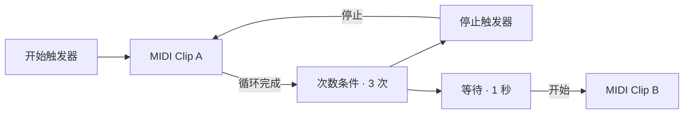

# Soundnet

Soundnet 是面向 macOS 的原生音乐节点工作流编辑器，提供独立 App 和可供 Logic Pro 加载的 Audio Unit v2 插件。当前版本为 **2.1**。

**输入 → 节点处理 → 输出**

以“一切皆节点”为设计原则，通过接线组合 MIDI、音频和逻辑控制。合成器、效果器、节奏编排和模型处理都可以成为工作流的一部分。

每个节点实例拥有独立的 ID、参数、素材和运行状态。右键画布即可插入全部类型的节点，同类节点可重复添加。节点数量没有预设槽位上限，实际规模取决于可用内存与实时处理能力。


## 节点

| 分类 | 可插入的节点 |
| --- | --- |
| 输入 | 本地 MIDI、DAW MIDI、MIDI Clip、硬件音频输入、DAW 音频输入、和弦输入、和声走向、节奏速度、DAW 时钟 |
| 处理 | 三声部编排器、振荡器、ARP、力度自动化、音符模型、混音器、EQ、Delay |
| 逻辑 | 开始触发器、停止触发器、等待、次数条件 |
| 输出 | 硬件音频输出、DAW 音频输出、MIDI 输出 |

本地 MIDI、DAW MIDI 和 MIDI Clip 分别是独立节点。硬件与 DAW 的音频输入输出、模块 BPM 与 DAW 时钟也分别提供独立节点。

## 信号与连接

| 信号 | 颜色 | 用途 |
| --- | --- | --- |
| MIDI 音符 | 橙色 | 传递音高、力度与音符的开始、结束，驱动音符处理、振荡器或 MIDI 输出 |
| 立体声音频 | 绿色 | 在音频输入、音源、混音、效果和音频输出之间传递声音 |
| 逻辑触发 | 红色 | 发送开始、停止和条件满足事件，控制播放器或继续触发链路 |
| 时钟 | 紫色 | 从节奏速度或 DAW 时钟节点，为 Clip、ARP、走向和力度节点提供时间来源 |

一个输出可以连接多个下游节点。普通输入接收一个来源，接入新线会替换原线；触发输入可以同时接收多个来源。接线会检查信号类型、节点引用和依赖关系。

音频和音符处理按无回路的依赖顺序执行。触发反馈通过播放器状态或等待队列处理，例如 Clip 的循环完成信号可以经计数和停止节点返回该 Clip。

## 快速开始

1. 打开独立版 Soundnet，点工具条「打开」。
2. 载入 [三次循环后等待示例](examples/three-loops-then-wait.json)。
3. 选择「开始触发器」，点右侧「发送触发信号」。

第一个 Clip 播放三轮后停止，等待一秒，再启动第二个 Clip。两个 Clip 拥有各自的素材和播放状态，分别经过振荡器后送入混音器。示例内嵌 MIDI 与模型映射，载入后即可使用。



示例使用独立版的「硬件音频输出」。在 AU 中载入后，删除该输出，从右键菜单添加「DAW 音频输出」，再把混音器接过去。

## 搭建自己的工作流

- 右键画布，从输入、处理、逻辑、输出分类插入节点。
- 拖动节点移动位置，拖输出圆点到输入圆点建立连接。
- 选择节点，在右侧编辑该实例。右键可复制、断开或删除选中节点。复制会生成新 ID，并复制参数和素材。
- 拖空白处平移，滚轮移动画布，Command + 滚轮缩放。「适配」显示整张图。
- 「撤销」「重做」支持节点、参数、连线和素材编辑。
- 「停音」停止当前播放与音符。独立版也可使用 Command + .。

可以从以下线路开始组合。

| 目标 | 线路 |
| --- | --- |
| 演奏合成音色 | 本地 MIDI → 振荡器 → 硬件音频输出 |
| 在 Logic 中演奏 | DAW MIDI → ARP → 振荡器 → DAW 音频输出 |
| 处理外部声音 | 硬件音频输入 → EQ → Delay → 硬件音频输出 |
| 用模型驱动其他乐器 | MIDI Clip → 音符模型 → MIDI 输出 |
| 条件控制 | Clip 循环完成 → 次数条件 → 停止触发器 → Clip |

## 音乐与逻辑处理

**三声部编排器**

右键画布，在「处理」中插入「三声部编排器」。把 MIDI Clip、和声走向或键盘的音符输出接到输入端。右侧的高、中、低三个 MIDI 出口可以分别接振荡器、ARP 或其他音符处理节点。

| 声部 | 默认音域（含首尾，中央 C = MIDI 60） | 默认织体 | 同时输入 C4、E4、G4 时 |
| --- | --- | --- | --- |
| 高 | 72–95（C5–B6） | 最高音 | G5（79） |
| 中 | 55–71（G3–B4） | 中间音 | E4（64） |
| 低 | 36–54（C2–F♯3） | 最低音 | C3（48） |

每一路都能修改上下限，从最高音、中间音、最低音和柱式和弦中选一种织体。编排器按原始音高选音，并尽量少移八度，使输出落在设定音域。窄音域容不下的音名会跳过。中间音在偶数个候选音中取偏低的一个；柱式和弦保留所有可用音，同一通道折叠到同一音高时合并。松开当前旋律音，仍按住的其他音会按同一规则接替。

打开[三声部编排示例](examples/three-voice-arrangement.json)，即可听到 C、Am、F、G 以 96 BPM 循环，三个声部各驱动一个振荡器。试着把中声部改成柱式和弦，或在中声部出口与振荡器之间加入启用的 ARP。示例同时接好硬件与 DAW 音频输出，独立 App 和 Logic 插件均可使用。

**振荡器与效果**

每个振荡器拥有自己的波形、音高、电平和 A/D/S/R 包络。Wave 0、1、2、3 分别对应正弦、方波、锯齿、三角波。音频处理提供四路混音、三段 EQ 和立体声 Delay，可添加多个实例串联或并联。

**ARP、和弦与力度**

ARP 提供直拍、Bossa Nova、Reggae、Disco、十六分音符节奏，支持每音重复 1–8 次。和弦与走向支持预制入口和手动输入，例如 `F#m7` 或 `Cmaj7 | Am7 | Dm7 | G7`。走向最多八个和弦。力度节点可按周期改变经过的新音符力度。

**MIDI Clip 与时钟**

每个 Clip 可独立载入标准 MIDI 文件，设置单次或循环播放。模块时间来自「节奏速度」，宿主时间来自「DAW 时钟」。使用宿主时间时，Clip 会跟随播放、停止和定位。

**触发器**

开始、停止节点可以手动发送命令，也可把上游触发转换为相应命令。等待节点按秒延后转发收到的命令。次数条件每收到 X 次信号后输出一次，再开始下一轮计数。MIDI Clip 提供独立的「循环完成」触发输出。

## 独立 App 与 DAW

| 接口 | 独立 App | AU 插件 |
| --- | --- | --- |
| 本地 MIDI | 屏幕琴键、电脑键盘、连接的 CoreMIDI 输入 | 插件屏幕琴键 |
| DAW MIDI | 外部 DAW 发送至 `Soundnet MIDI In` | 当前乐器轨的现场演奏与 MIDI 区域 |
| 硬件音频 | 系统选定的输入和输出设备 | 使用 DAW 的音频路由 |
| DAW 音频 | 使用独立版硬件路由 | 侧链输入、当前乐器轨的立体声输出 |
| DAW 时钟 | 虚拟端口接收 MIDI Clock 与走带消息 | 宿主 BPM、播放状态和拍位置 |
| MIDI 输出 | `Soundnet MIDI Out` 虚拟源 | 宿主的 AU MIDI 输出回调 |

独立版的硬件音频输入需要在节点面板中启用，首次启用会请求麦克风权限。MIDI 输出的接收方式取决于下游软件或 AU 宿主。

独立版电脑键盘 `A W S E D F T G Y H U J K` 演奏 C4–C5，`Z` / `X` 切换八度。

## 本地模型

音符模型节点支持 `.mlmodel`、`.mlpackage`、`.mlmodelc`，以及包含 128 项 `pitches` 的 JSON 音高映射。

Core ML 接口目前支持一个 Int64 或 Double 标量音高输入和一个标量音高输出。导入阶段对 MIDI 音高 0–127 计算映射，实时演奏读取结果。每个模型实例拥有自己的映射，并随工作流保存，适用于单音高、无状态的处理。

[PitchMirror.mlmodel](examples/PitchMirror.mlmodel) 将音高 `p` 映射为 `127 − p`。可搭配 [FourBeat.mid](examples/FourBeat.mid) 试验。

## 保存与兼容

「保存」导出版本 3 JSON，包含实例 ID、类型、位置、每实例参数、素材和连线。「打开」支持旧版工作流，并转换成独立实例。

独立版退出时记住当前图，AU 随宿主工程保存。实例参数通过工作流编辑器修改并随图保存；逐实例 DAW 参数自动化待实现。旧 AU 参数 ID 继续用于旧音色兼容。

## 构建与安装

需要 macOS 13 或更新版本，以及支持 C++23 的 Xcode Command Line Tools。

```sh
./build-all.sh
```

产物位于 `build/release/Soundnet.app` 和 `build/release/Soundnet.component`，包含 arm64 与 x86_64，并使用本地签名。

把 component 放到 `~/Library/Audio/Plug-Ins/Components/`，重新打开 Logic，在软件乐器插槽选择「AU Instruments → Soundnet → Soundnet」。AU 沿用初版的四字符标识，同一插件目录安装一份 Soundnet 或旧版 Ternary 即可。

## 验证与源码

```sh
mkdir -p build/tests
xcrun clang++ -std=c++17 -O2 tests/InstanceGraphTests.cpp -o build/tests/instance-tests
build/tests/instance-tests
xcrun clang++ -std=c++17 -O2 tests/ArrangerTests.cpp -o build/tests/arranger-tests
build/tests/arranger-tests
auval -strict -v aumu Tern Trny
auval -strict -v aumu Tern Trny -oop
```

已验证 40 个实例的编译与渲染、25 个原生界面实例的添加与撤销重做、独立 Clip、三次循环停止、延迟启动，以及 AU 进程内和跨进程的图状态恢复与实际发声。硬件运行验证在 Apple Silicon 上完成，Intel 版本已编译。Logic 工程内的手动操作仍待验证。

| 路径 | 内容 |
| --- | --- |
| `src/GraphSpec.hpp` | 实例、端口类型、连接与依赖验证 |
| `src/InstanceGraph.hpp` | 实例运行时、执行计划、音频与触发调度 |
| `src/Engine.hpp` | 实例图与旧引擎的入口 |
| `src/LegacyEngine.hpp` | 复用的 DSP 与旧音色兼容 |
| `ui/InstanceEditor.mm` | 原生节点画布与实例编辑 |
| `app/`、`au/` | 独立版和 Audio Unit 宿主接口 |
| `examples/`、`tests/`、`tools/` | 示例、引擎与原生集成验证 |

更多操作见 [中文使用说明](docs/使用说明.txt)。Apple AudioUnitSDK 第三方源码与 Apache 2.0 许可证位于 `au/vendor/`。
