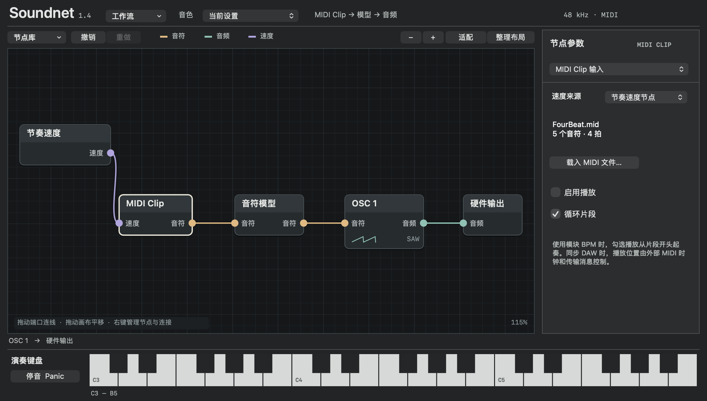
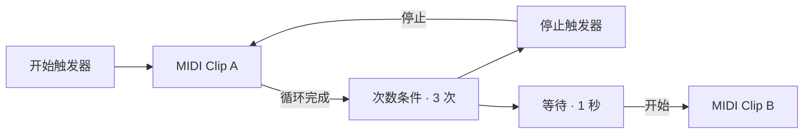

# Soundnet

Soundnet 是面向 macOS 的原生音乐节点工作流编辑器，提供独立 App 和可供 Logic Pro 加载的 Audio Unit v2 插件。当前版本为 **2.48**。

**输入 → 节点处理 → 输出**

以“一切皆节点”为设计原则，通过接线组合 MIDI、音频和逻辑控制。合成器、效果器、节奏编排和模型处理都可以成为工作流的一部分。

每个节点实例拥有独立的 ID、参数、素材和运行状态。右键画布即可插入全部类型的节点，同类节点可重复添加。节点数量没有预设槽位上限，实际规模取决于可用内存与实时处理能力。



## 节点

| 分类 | 可插入的节点 |
| --- | --- |
| 输入 | 本地 MIDI、DAW MIDI、MIDI Clip、硬件音频输入、DAW 音频输入、和弦输入、和声走向、节奏速度、DAW 时钟 |
| 处理 | 三声部编排器、振荡器、采样器、音频片段、压缩器、限幅器、合唱、颤音、位深破碎、音阶量化、ARP、力度自动化、音符模型、混音器、EQ、Delay、滤波器、混响、噪声 |
| 逻辑 | 开始触发器、停止触发器、等待、次数条件 |
| 输出 | 硬件音频输出、DAW 音频输出、MIDI 输出 |

本地 MIDI、DAW MIDI 和 MIDI Clip 分别是独立节点。硬件与 DAW 的音频输入输出、模块 BPM 与 DAW 时钟也分别提供独立节点。

## 信号与连接

| 信号 | 颜色 | 用途 |
| --- | --- | --- |
| MIDI 音符 | 橙色 | 传递音高、力度与音符的开始、结束，驱动音符处理、振荡器、采样器或 MIDI 输出 |
| 立体声音频 | 绿色 | 在音频输入、音源、混音、效果和音频输出之间传递声音 |
| 逻辑触发 | 红色 | 发送开始、停止和条件满足事件，控制播放器或继续触发链路 |
| 时钟 | 紫色 | 从节奏速度或 DAW 时钟节点，为 Clip、ARP、走向和力度节点提供时间来源 |

一个输出可以连接多个下游节点。普通输入接收一个来源，接入新线会替换原线；触发输入可以同时接收多个来源。接线会检查信号类型、节点引用和依赖关系。

音频和音符处理按无回路的依赖顺序执行。触发反馈通过播放器状态或等待队列处理，例如 Clip 的循环完成信号可以经计数和停止节点返回该 Clip。

## 快速开始

1. 打开独立版 Soundnet，点工具条「打开」。
2. 载入 [三次循环后等待示例](examples/three-loops-then-wait.json)。
3. 选择「开始触发器」，点右侧「发送触发信号」。

第一个 Clip 播放三轮后停止，等待一秒，再启动第二个 Clip。两个 Clip 拥有各自的素材和播放状态，分别经过振荡器后送入混音器。示例内嵌 MIDI 与模型映射，载入后即可使用。



示例使用独立版的「硬件音频输出」。在 AU 中载入后，删除该输出，从右键菜单添加「DAW 音频输出」，再把混音器接过去。

## 搭建自己的工作流

- 右键画布，从输入、处理、逻辑、输出分类插入节点。
- 拖动节点移动位置，拖输出圆点到输入圆点建立连接。
- 选择节点，在右侧编辑该实例。Shift 点击增减选择，Shift 拖动空白处框选；拖动任一选中节点会整体移动。
- Cmd+C / Cmd+V 复制粘贴节点及其内部连线，Cmd+X 剪切，Cmd+A 全选，Delete 删除；选中连线后按 Delete 可单独删除连线。方向键微调位置，按住 Shift 每次移动 10 点。
- 工具条「吸附」开启 20 点网格，拖动节点时自动对齐。「查找」可按名称或编号定位节点。
- 拖空白处平移，滚轮移动画布，Command + 滚轮缩放。「适配」显示整张图。
- 「撤销」「重做」支持节点、参数、连线和素材编辑，保留最近 64 步。
- 数值参数在右侧提供滑块和精确输入框；整数参数按整数取值。滤波器、混响、延迟、压缩器、限幅器、合唱、颤音、位深破碎、相位器和音阶量化还提供常用预设与「恢复默认参数」。
- 「导出」把当前图离线渲染为 1–120 秒立体声 WAV；「文件 → 导出分轨…」会为每个音频输出节点单独渲染一条 WAV 分轨。开始触发器会自动触发一次；只有 DAW 音频输出的图会自动改走硬件输出路径。没有开始触发器的图导出为静音；采样器还需要 Note 输入才能发声；音频片段需要开始触发器启动。
- 「文件 → 导出 MIDI…」把图中的 MIDI 输出节点录成多轨标准 MIDI 文件，方便继续在 DAW 或乐器中编辑。
- 「停音」停止当前播放与音符。独立版也可使用 Command + .。

可以从以下线路开始组合。

| 目标 | 线路 |
| --- | --- |
| 演奏合成音色 | 本地 MIDI → 振荡器 → 硬件音频输出 |
| 在 Logic 中演奏 | DAW MIDI → ARP → 振荡器 → DAW 音频输出 |
| 处理外部声音 | 硬件音频输入 → EQ → Delay → 硬件音频输出 |
| 滤波与空间 | 振荡器 → 滤波器 → 混响 → 音频输出 |
| 采样演奏 | 本地 MIDI → 采样器 → 滤波器 → 硬件音频输出 |
| 播放音频片段 | 开始触发器 → 音频片段 → 压缩器 → 硬件音频输出 |
| 母带限幅 | 音频片段 → 压缩器 → 限幅器 → 硬件音频输出 |
| 噪声纹理 | 噪声 → 滤波器 → 混音器 → 音频输出 |
| 用模型驱动其他乐器 | MIDI Clip → 音符模型 → MIDI 输出 |
| MIDI 导出 | 开始触发器 → MIDI Clip → MIDI 输出 |
| 条件控制 | Clip 循环完成 → 次数条件 → 停止触发器 → Clip |

## 音乐与逻辑处理

**三声部编排器**

右键画布，在「处理」中插入「三声部编排器」。把 MIDI Clip、和声走向或键盘的音符输出接到输入端。右侧的高、中、低三个 MIDI 出口可以分别接振荡器、ARP 或其他音符处理节点。

| 声部 | 默认音域（含首尾，中央 C = MIDI 60） | 默认织体 | 同时输入 C4、E4、G4 时 |
| --- | --- | --- | --- |
| 高 | 72–95（C5–B6） | 最高音 | G5（79） |
| 中 | 55–71（G3–B4） | 中间音 | E4（64） |
| 低 | 36–54（C2–F♯3） | 最低音 | C3（48） |

每一路都能修改上下限，从最高音、中间音、最低音和柱式和弦中选一种织体。编排器按原始音高选音，并尽量少移八度，使输出落在设定音域。窄音域容不下的音名会跳过。中间音在偶数个候选音中取偏低的一个；柱式和弦保留所有可用音，同一通道折叠到同一音高时合并。松开当前旋律音，仍按住的其他音会按同一规则接替。

打开[三声部编排示例](examples/three-voice-arrangement.json)，即可听到 C、Am、F、G 以 96 BPM 循环，三个声部各驱动一个振荡器。试着把中声部改成柱式和弦，或在中声部出口与振荡器之间加入启用的 ARP。示例同时接好硬件与 DAW 音频输出，独立 App 和 Logic 插件均可使用。

**振荡器与效果**

把 `.mid` / `.midi` 文件拖到画布会创建 MIDI Clip；把 `.wav` / `.aif` / `.aiff` / `.aifc` / `.mp3` / `.m4a` / `.aac` / `.caf` / `.flac` 拖入会创建采样器，按住 Option 拖入则创建音频片段；`.mlmodel` 会创建音符模型。资源随工程一起内嵌，拖入后仍可正常保存、撤销和恢复。

每个振荡器拥有自己的波形、音高、电平和 A/D/S/R 包络。Wave 0、1、2、3 分别对应正弦、方波、锯齿、三角波。音频处理提供四路混音、三段 EQ、立体声 Delay、状态变量滤波器、Freeverb 混响、立体声压缩器、母带限幅器、立体声合唱、颤音和位深破碎。

滤波器支持低通、高通、带通三种模式，可调截止频率、共振和驱动；混响可调干湿比、空间大小、阻尼和立体声宽度；噪声节点提供白噪声和粉红噪声。压缩器提供阈值、压缩比、起音、释放、补偿增益和干湿比，并带侧链输入：把另一路音频接到第二个 Audio 输入，压缩器会用侧链电平触发主信号闪避；限幅器用阈值、输出上限、释放和输入增益做最后的峰值控制；合唱用 LFO 调制短延迟并混合干声，提供 Rate/Depth/Mix/Delay 四个参数；相位器用四级全通滤波和 LFO 扫频，提供 Rate/Depth/Feedback/Mix。EQ、Delay、滤波器、混响、噪声、音频片段、压缩器、限幅器、合唱、颤音、位深破碎、相位器和三个音频输出都支持旁通：旁通只跳过处理，保留原有连线，适合对比效果或暂时让某个音源静音。

打开[滤波与混响示例](examples/filter-reverb-noise.json)，可听到振荡器经过滤波和混响，并与粉红噪声混合。

**采样器**

右键插入「采样器」，在右侧点「载入音频（WAV / AIFF / MP3 / M4A / AAC / CAF / FLAC）…」选择文件。采样器支持 16 个复音声部：每个音符从原始音高按十二平均律移调播放，可使用音域起点/终点、循环、起音、释放和增益塑造声音。Root 是素材的原始 MIDI 音高，中央 C 为 60；Start/End 是 0–1 的采样区间；Loop 打开后在区间内循环，关闭则播放到终点后释放；Reverse 从区间末尾反向播放，Velocity 控制力度敏感度（0 忽略力度，1 完全跟随）。

WAV/AIFF 由内置解码器读取（8/16/24/32 位整数、32 位浮点、`sowt`/`fl32`）；MP3/M4A/AAC/CAF/FLAC 由 AVFoundation 解码成浮点 PCM。单个文件最大 64 MB，解码后最多约 4M 个采样点（48 kHz 立体声约 40 秒）。采样数据以浮点 PCM 嵌入版本 3 JSON，工程可脱离原文件移动。

打开[采样器示例](examples/sampler-pluck.json)，用键盘或 MIDI 演奏 C4 即可听到经过低通滤波和混响的拨弦采样。

**音频片段与效果**

右键插入「音频片段」，在右侧载入音频（支持与采样器相同的格式）。把开始触发器接到它的触发输入即可播放，停止触发器会淡出停止；Loop 打开后循环 Start/End 区间，Fade 控制起止淡入淡出，Gain 控制片段增益；Pitch 以半音移调，Reverse 从区间末尾反向播放。音频片段不需要 Note 输入，适合铺底、循环采样和整段音频。

「压缩器」是立体声联动的峰值压缩器：Threshold 为 -60–0 dB，Ratio 为 1–20，Attack/Release 以秒为单位，Makeup 为 0–2 的补偿增益，Mix 为干湿比。把压缩器接在音频片段或混音器之后，可压住峰值并提高整体密度。

「限幅器」是母带链的最后一级：Threshold 决定开始压制的电平，Ceiling 是硬输出上限（-12–0 dB），Release 控制恢复速度，Gain 是输入增益。它用快速起音包络和逐采样上限钳制，适合放在压缩器与音频输出之间，防止峰值过载。

「合唱」是立体声调制延迟：Rate 为 0.05–8 Hz 的 LFO 速度，Depth 为 0–1 的调制深度，Mix 为 0–1 干湿比，Delay 为 1–30 ms 基础延迟。左右声道使用相位差 LFO，可给采样器、音频片段或合成器增加宽度。

「颤音」用 0.1–20 Hz 正弦 LFO 调制左右声道音量，Depth 为 0–1 深度，Stereo 为左右相位差，Mix 为干湿比；「位深破碎」用 1–16 bit 量化和 500–48000 Hz 采样保持做 lo-fi 处理，Mix 为干湿比。打开[颤音与破碎示例](examples/tremolo-crush.json)试听。
「音阶量化」接收 Note 输入，把音高吸附到指定调性：Root 0–11（C–B），Scale 0 大调 1 自然小调 2 多利亚 3 大调五声 4 半音，Mode 0 最近音 1 向上 2 向下。同一个输出音高由多个输入音符共享时会正确计数，最后一个释放才发出 Note Off；修改参数时仍按住的音符会重新量化。打开[随机触发示例](examples/random-gate.json)、[节拍器示例](examples/metronome-click.json)、[移调示例](examples/transpose.json)、[音符回声示例](examples/note-echo.json)或[音阶量化示例](examples/scale-quantizer.json)，开始触发器会播放经过小调量化的 Clip。

打开[音频片段与压缩示例](examples/audio-clip-compressor.json)，点开始触发器即可听到循环片段经过压缩和补偿增益；[母带限幅示例](examples/master-limiter.json)在压缩器后串联限幅器，适合对比输出上限。

打开[MIDI 输出示例](examples/clip-to-midi.json)，在「文件 → 导出 MIDI…」中可把 Clip 的音符录成 `.mid` 文件。

**ARP、和弦与力度**

ARP 提供直拍、Bossa Nova、Reggae、Disco、十六分音符节奏，支持每音重复 1–8 次。和弦与走向支持预制入口和手动输入，例如 `F#m7` 或 `Cmaj7 | Am7 | Dm7 | G7`。走向最多八个和弦。力度节点可按周期改变经过的新音符力度。

**MIDI Clip 与时钟**

每个 Clip 可独立载入标准 MIDI 文件，设置单次或循环播放。模块时间来自「节奏速度」，宿主时间来自「DAW 时钟」。使用宿主时间时，Clip 会跟随播放、停止和定位。选中 Clip 后点右侧「编辑音符…」可打开钢琴卷帘：单击空白添加音符，拖动移动，拖右边缘改长度，右键或 Delete 删除；底部可改总长度、音符长度和力度，应用后会写回内嵌 MIDI 并支持撤销。

**触发器**

开始、停止节点可以手动发送命令，也可把上游触发转换为相应命令。等待节点按秒延后转发收到的命令。次数条件每收到 X 次信号后输出一次，再开始下一轮计数。随机触发按 Chance 概率决定是否把触发继续传递，可用于生成式段落。节拍器在收到开始触发后按 BPM 发声，停止触发后静音。移调节点把输入音符按半音移动。音符回声按时间安排多次延迟重复；通道过滤只放行指定 MIDI 通道；注释节点用于在画布上记录说明；音频菜单可播放/停止所有开始/停止触发器；颤音支持按工程 BPM 同步；合唱新增反馈；混响新增 PreDelay；钢琴卷帘可试听选中音符。噪声门压低低于阈值的音频。MIDI Clip 提供独立的「循环完成」触发输出。

## 独立 App 与 DAW

| 接口 | 独立 App | AU 插件 |
| --- | --- | --- |
| 本地 MIDI | 屏幕琴键、电脑键盘、连接的 CoreMIDI 输入 | 插件屏幕琴键 |
| DAW MIDI | 外部 DAW 发送至 `Soundnet MIDI In` | 当前乐器轨的现场演奏与 MIDI 区域 |
| 硬件音频 | 系统选定的输入和输出设备 | 使用 DAW 的音频路由 |
| DAW 音频 | 使用独立版硬件路由 | 侧链输入、当前乐器轨的立体声输出 |
| DAW 时钟 | 虚拟端口接收 MIDI Clock 与走带消息 | 宿主 BPM、播放状态和拍位置 |
| MIDI 输出 | `Soundnet MIDI Out` 虚拟源 | 宿主的 AU MIDI 输出回调 |

独立版的硬件音频输入需要在节点面板中启用，首次启用会请求麦克风权限。MIDI 输出的接收方式取决于下游软件或 AU 宿主。

独立版电脑键盘 `A W S E D F T G Y H U J K` 演奏 C4–C5，`Z` / `X` 切换八度。

## 本地模型

音符模型节点支持 `.mlmodel`、`.mlpackage`、`.mlmodelc`，以及包含 128 项 `pitches` 的 JSON 音高映射。

Core ML 接口目前支持一个 Int64 或 Double 标量音高输入和一个标量音高输出。导入阶段对 MIDI 音高 0–127 计算映射，实时演奏读取结果。每个模型实例拥有自己的映射，并随工作流保存，适用于单音高、无状态的处理。

[PitchMirror.mlmodel](examples/PitchMirror.mlmodel) 将音高 `p` 映射为 `127 − p`。可搭配 [FourBeat.mid](examples/FourBeat.mid) 试验。

## 保存与兼容

「保存」导出版本 3 JSON，包含实例 ID、类型、位置、每实例参数、旁通状态、MIDI/模型/音频素材和连线。「打开」支持旧版工作流，并转换成独立实例。

「导出」只读取当前图，不依赖实时音频设备：工具条点击后选择 WAV 路径、采样率（44.1/48/96 kHz）和位深（16/24-bit），即离线渲染所选时长并写出立体声文件。导出开始时会给图中的开始触发器发送一次脉冲；Clip、ARP 等由触发器启动的播放器会从头播放。只有 DAW 音频输出的图会自动把输出接到硬件输出路径，因此独立版和 AU 中的图都能导出。采样器节点需要上游 Note 输入，没有音符来源时导出为静音；音频片段需要开始触发器才会发声。

「文件 → 导出分轨…」选择一个文件夹后，会把图中每个音频输出节点（硬件输出、DAW 输出或旧版音频输出）单独渲染成 `stem-<节点ID>.wav`，其他输出节点在各自分轨中自动旁通，方便在 DAW 中继续混音。采样率与位深选项与整轨导出相同。

「文件 → 录制输出…」会把当前最终输出录成 16-bit 立体声 WAV（最长 60 秒）。录制在实时音频线程中只做无锁拷贝，停止后在主线程写盘；超过 60 秒会截断并在完成后提示。录制文件可以再拖入或通过采样器、音频片段的载入按钮使用。

「文件 → 导出 MIDI…」使用同一套离线渲染，捕获 MIDI 输出节点发出的音符和控制器事件，并写成标准 MIDI 文件。文件采用 480 PPQ 的时间基准，速度取图中第一个「节奏速度」节点的 BPM（缺省 120）；导出为格式 1 多轨文件：速度轨加每个使用中的 MIDI 通道各一轨；导出时长仍为 1–120 秒。

独立版退出时记住当前图，AU 随宿主工程保存。实例参数通过工作流编辑器修改并随图保存；逐实例 DAW 参数自动化待实现。旧 AU 参数 ID 继续用于旧音色兼容。

## 构建与安装

需要 macOS 13 或更新版本，以及支持 C++23 的 Xcode Command Line Tools。

```sh
./build-all.sh
```

产物位于 `build/release/Soundnet.app` 和 `build/release/Soundnet.component`，包含 arm64 与 x86_64，并使用本地签名。

把 component 放到 `~/Library/Audio/Plug-Ins/Components/`，重新打开 Logic，在软件乐器插槽选择「AU Instruments → Soundnet → Soundnet」。AU 沿用初版的四字符标识，同一插件目录安装一份 Soundnet 或旧版 Ternary 即可。

无界面导出与自检：

```sh
build/release/Soundnet.app/Contents/MacOS/Soundnet --export examples/three-loops-then-wait.json out.wav 8
build/release/Soundnet.app/Contents/MacOS/Soundnet --export-midi examples/three-loops-then-wait.json out.mid 8
build/release/Soundnet.app/Contents/MacOS/Soundnet --self-test
```

`--export` 和 `--export-midi` 与界面导出使用同一套离线渲染逻辑，适合脚本化验证或批量生成音频与 MIDI。

## 验证与源码

```sh
./scripts/test-all.sh build/tests
./scripts/verify-release.sh build/verify
build/release/Soundnet.app/Contents/MacOS/Soundnet --export examples/three-loops-then-wait.json out.wav 8
auval -strict -v aumu Tern Trny
auval -strict -v aumu Tern Trny -oop
```

已验证 40 个实例的编译与渲染、25 个原生界面实例的添加与撤销重做、多选复制粘贴、拖入音频/MIDI、独立 Clip、三次循环停止、延迟启动、滤波器 / 混响 / 噪声 / 采样器 / 音频片段 / 压缩器 / 限幅器 / 合唱 / 颤音 / 位深破碎 / 相位器 / 音阶量化 / 移调 / 音符回声 / 噪声门 / 随机触发 / 节拍器 / 旁通、WAV 与 AIFF 解码、16/24-bit 与 44.1/48/96 kHz 离线导出、实时录制、MIDI 输出捕获与多轨 SMF 导出、音频片段反向/移调、采样器反向/力度、压缩音频导入、分轨导出、节点预设、命令行导出，以及 AU 进程内和跨进程的图状态恢复与实际发声。硬件运行验证在 Apple Silicon 上完成，Intel 版本已编译。Logic 工程内的手动操作仍待验证。

| 路径 | 内容 |
| --- | --- |
| `src/GraphSpec.hpp` | 实例、端口类型、连接与依赖验证 |
| `src/InstanceGraph.hpp` | 实例运行时、执行计划、音频与触发调度 |
| `src/NodeRegistry.hpp` | 节点 ID、标题、分类、参数元数据与菜单顺序 |
| `src/DspNodes.hpp` | 滤波器、混响、噪声、压缩器、限幅器、合唱、颤音与位深破碎 DSP |
| `src/AudioSample.hpp` | 内嵌采样数据与音高/时长描述 |
| `src/AudioFile.hpp` | WAV/AIFF 解码与采样导入限制 |
| `src/OfflineRender.hpp` | 无宿主的图渲染与 MIDI 捕获、导出输出重定向 |
| `src/MidiFileWriter.hpp` | 标准 MIDI 文件写入 |
| `src/WavFile.hpp` | 16/24 位立体声 WAV 写入 |
| `src/Engine.hpp` | 实例图与旧引擎的入口 |
| `src/LegacyEngine.hpp` | 复用的 DSP 与旧音色兼容 |
| `ui/InstanceEditor.mm` | 原生节点画布与实例编辑 |
| `app/`、`au/` | 独立版和 Audio Unit 宿主接口 |
| `examples/`、`tests/`、`tools/` | 示例、引擎与原生集成验证 |
| `scripts/test-all.sh` | 编译并运行全部引擎、素材与渲染测试 |
| `scripts/verify-release.sh` | 一条命令完成测试、双架构构建、签名、自检、示例导出与 MIDI 导出验证 |
| `CHANGELOG.md` | 版本更新记录 |

更多操作见 [中文使用说明](docs/使用说明.txt)。Apple AudioUnitSDK 第三方源码与 Apache 2.0 许可证位于 `au/vendor/`。
