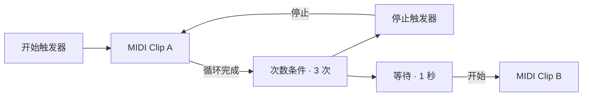

# Soundnet

[English](README.md) · 简体中文

Soundnet 是面向 macOS 的原生音乐节点工作流编辑器，提供独立 App 和可供 Logic Pro 加载的 Audio Unit v2 插件。当前版本为 **3.0.0**。

**输入 → 节点处理 → 输出**

以“一切皆节点”为设计原则，通过接线组合 MIDI、音频和逻辑控制。合成器、效果器、节奏编排和模型处理都可以成为工作流的一部分。

每个节点实例拥有独立的 ID、参数、素材和运行状态。右键画布即可插入普通节点，同类实例可重复添加；时间码与项目设定是各一个的工程环境节点。工程规模上限为 4096 个节点、16384 条连线；实际可运行规模取决于内存与实时处理能力。


## 节点

| 分类 | 可插入的节点 |
| --- | --- |
| 工程 | 时间码、项目设定 |
| 输入 | 本地 MIDI、DAW MIDI、MIDI Clip、音频输入、和弦输入、和声走向、YuE2 生成、ACE-Step 生成 |
| 处理 | 增益、MIDI 音区分流、三声部编排器、振荡器、采样器、音频片段、压缩器、限幅器、合唱、颤音、位深破碎、音阶量化、ARP、力度自动化、音符模型、混音器、EQ、Delay、滤波器、混响、噪声 |
| 逻辑 | 开始触发器、停止触发器、等待、次数条件 |
| 输出 | 音频输出、MIDI 输出 |

YuE2 生成、ACE-Step 生成是两个独立节点，各自在本机后台调用 audio.cpp 命令行。平台统一管理当前产物和全部历史 take 的音频、ABC 乐谱，保存工程时写入同名 `.assets` 目录。项目设定中的工程文件夹是默认保存位置；节点不再自行管理额外归档路径。图内播放走「触发」端口与音频输出。节点面板提供生成/停止/进度、记录列表，以及独立的试听播放器（播放/暂停/停止/可拖动导航条）。YuE2 同时返回 ABC 乐谱，可导入为 MIDI Clip 在钢琴卷帘里编辑，改完再回喂重渲染。

新建工程自动包含时间码和项目设定各一个。时间码提供公共时间位置，相关节点自行设置 BPM、拍号或节奏型；不设置项目全局 BPM 或独立节奏节点。项目设定包含处理采样率、处理精度、导出位深与音频设备，AU 的设备与实际采样率由宿主管理。

## 信号与连接

| 信号 | 颜色 | 用途 |
| --- | --- | --- |
| MIDI 音符 | 橙色 | 传递音高、力度与音符的开始、结束，驱动音符处理、振荡器、采样器或 MIDI 输出 |
| 立体声音频 | 绿色 | 在音频输入、音源、混音、效果和音频输出之间传递声音 |
| 逻辑触发 | 红色 | 发送开始、停止和条件满足事件，控制播放器或继续触发链路 |
| 时间码 | 紫色 | 传递公共时间位置和运行状态，相关节点按自己的节奏安排事件 |

一个输出可以连接多个下游节点。普通输入接收一个来源，接入新线会替换原线；触发输入可以同时接收多个来源。接线会检查信号类型、节点引用和依赖关系。

音频和音符处理按无回路的依赖顺序执行。触发反馈通过播放器状态或等待队列处理，例如 Clip 的循环完成信号可以经计数和停止节点返回该 Clip。

## 快速开始

1. 打开独立版 Soundnet，点工具条「打开」。
2. 载入 [三次循环后等待示例](examples/three-loops-then-wait.json)。
3. 点工具条「播放」，或选择「开始触发器」后点右侧「发送触发信号」。

第一个 Clip 播放三轮后停止，等待一秒，再启动第二个 Clip。两个 Clip 拥有各自的素材和播放状态，分别经过振荡器后送入混音器。示例内嵌 MIDI 与模型映射，载入后即可使用。



示例使用通用「音频输出」。独立 App 播放至项目所选设备，AU 返回宿主音轨，同一个工程可直接在两种模式下使用。

## 搭建自己的工作流

- 左侧「节点库」支持分类展开/收起、全部展开/收起，以及中英名称、分类和节点标识的即时搜索。搜索会临时展开匹配结果，清空后恢复原折叠状态；工具条「节点库」可隐藏整个左栏。按输入、处理、逻辑、注释、输出分组列出全部节点：单击插入到画布中央，也可以直接把条目拖到画布的任意位置。右键画布同样可以插入节点。
- 拖动节点移动位置，拖输出圆点到输入圆点建立连接。
- 选择节点，在右侧编辑该实例。Shift 点击增减选择，拖动空白处框选；拖动任一选中节点会整体移动。
- Cmd+C / Cmd+V 复制粘贴节点及其内部连线，Cmd+X 剪切，Cmd+A 全选，Delete 删除；选中连线后按 Delete 可单独删除连线。方向键微调位置，按住 Shift 每次移动 10 点。
- Shift+Cmd+G 或右键「编组选中节点」把当前选择放进一个分组框。拖动分组标题整体移动框内节点，双击标题重命名，右键解散（节点保留）。分组随工程一起保存。
- 工具条「吸附」开启 20 点网格，拖动节点时自动对齐。「查找」可按名称或编号定位节点。
- 空白处拖动框选，Option 拖动或中键拖动平移，滚轮移动画布。缩放条提供 −、百分比、＋ 和「适配」；Command + 滚轮或触控板捏合以光标为中心缩放。
- 窗口可以自由缩放，节点库、画布、检查器和键区会随窗口重排。状态栏右侧的「钢琴键盘」开关可隐藏键区，为画布腾出空间。
- 「撤销」「重做」支持节点、参数、连线和素材编辑，保留最近 64 步。
- 右上角可即时切换中文 / English，菜单、节点库、画布、检查器与说明同步更新，偏好会保留；语言切换不改工程标识、参数或自定义名称。
- 右侧检查器按音色、包络、播放区间、节奏同步、调制空间、混音等分组，同类参数集中显示，分组可折叠。分组来自节点描述符。数值参数提供滑块和精确输入框；整数参数按整数取值。滤波器、混响、延迟、压缩器、限幅器、合唱、颤音、位深破碎、相位器和音阶量化还提供常用预设与「恢复默认参数」。
- 「导出」把当前图离线渲染为 1–120 秒立体声 WAV；「文件 → 导出分轨…」会为每个音频输出节点单独渲染一条 WAV 分轨。开始触发器会自动触发一次。需要触发启动的节点应接开始触发器；采样器还需要 Note 输入才能发声；噪声或已启用播放的生成节点可自行发声。
- 「文件 → 导出 MIDI…」把图中的 MIDI 输出节点录成多轨标准 MIDI 文件，方便继续在 DAW 或乐器中编辑。
- 「停止」或 Command + . 停止全图播放与实时处理，清理音符、延迟触发、回声、节拍器和效果状态；也取消当前离线导出或素材载入。停止后，外部 MIDI、宿主走带或调参不会自动恢复。点击「播放」或手动发送开始触发器可重新启用。停止只改变运行状态，不改工程播放参数或撤销历史。
- 离线 WAV / MIDI / 分轨导出期间，可在状态栏点击「取消处理」。取消不覆盖目标文件；素材载入取消后不会应用结果（系统解码或 Core ML 调用需等本次调用返回）。

可以从以下线路开始组合。

| 目标 | 线路 |
| --- | --- |
| 演奏合成音色 | 本地 MIDI → 振荡器 → 音频输出 |
| 在 Logic 中演奏 | DAW MIDI → ARP → 振荡器 → 音频输出 |
| 处理外部声音 | 音频输入 → EQ → Delay → 音频输出 |
| 滤波与空间 | 振荡器 → 滤波器 → 混响 → 音频输出 |
| 采样演奏 | 本地 MIDI → 采样器 → 滤波器 → 音频输出 |
| 播放音频片段 | 开始触发器 → 音频片段 → 压缩器 → 音频输出 |
| 母带限幅 | 音频片段 → 压缩器 → 限幅器 → 音频输出 |
| 噪声纹理 | 噪声 → 滤波器 → 混音器 → 音频输出 |
| 用模型驱动其他乐器 | MIDI Clip → 音符模型 → MIDI 输出 |
| MIDI 导出 | 开始触发器 → MIDI Clip → MIDI 输出 |
| 条件控制 | Clip 循环完成 → 次数条件 → 停止触发器 → Clip |

## 音乐与逻辑处理

**三声部编排器**

右键画布，在「处理」中插入「三声部编排器」。把 MIDI Clip、和声走向或键盘的音符输出接到输入端。右侧的高、中、低三个 MIDI 出口可以分别接振荡器、ARP 或其他音符处理节点。

| 声部 | 默认音域（含首尾，中央 C = MIDI 60） | 默认织体 | 同时输入 C4、E4、G4 时 |
| --- | --- | --- | --- |
| 高 | 72–95（C5–B6） | 最高音 | G5（79） |
| 中 | 55–71（G3–B4） | 中间音 | E4（64） |
| 低 | 36–54（C2–F♯3） | 最低音 | C3（48） |

每一路都能修改上下限，从最高音、中间音、最低音和柱式和弦中选一种织体。编排器按原始音高选音，并尽量少移八度，使输出落在设定音域。窄音域容不下的音名会跳过。中间音在偶数个候选音中取偏低的一个；柱式和弦保留所有可用音，同一通道折叠到同一音高时合并。松开当前旋律音，仍按住的其他音会按同一规则接替。

打开[三声部编排示例](examples/three-voice-arrangement.json)，即可听到 C、Am、F、G 按节点自身速度循环，三个声部各驱动一个振荡器。试着把中声部改成柱式和弦，或在中声部出口与振荡器之间加入启用的 ARP。示例使用同一个音频输出，独立 App 和 Logic 插件均可使用。

**振荡器与效果**

把 `.mid` / `.midi` 文件拖到画布会创建 MIDI Clip；把 `.wav` / `.aif` / `.aiff` / `.aifc` / `.mp3` / `.m4a` / `.aac` / `.caf` / `.flac` 拖入会创建采样器，按住 Option 拖入则创建音频片段；`.mlmodel` 会创建音符模型。保存时资源写入同名 .assets 目录，工程文件保存相对引用。

每个振荡器拥有自己的波形、音高、电平和 A/D/S/R 包络。Wave 0、1、2、3 分别对应正弦、方波、锯齿、三角波。音频处理提供四路混音、三段 EQ、立体声 Delay、状态变量滤波器、Freeverb 混响、立体声压缩器、母带限幅器、立体声合唱、颤音和位深破碎。

滤波器支持低通、高通、带通三种模式，可调截止频率、共振和驱动；混响可调干湿比、空间大小、阻尼和立体声宽度；噪声节点提供白噪声和粉红噪声。压缩器提供阈值、压缩比、起音、释放、补偿增益和干湿比，并带侧链输入：把另一路音频接到第二个 Audio 输入，压缩器会用侧链电平触发主信号闪避；限幅器用阈值、输出上限、释放和输入增益做最后的峰值控制；合唱用 LFO 调制短延迟并混合干声，提供 Rate/Depth/Mix/Delay 四个参数；相位器用四级全通滤波和 LFO 扫频，提供 Rate/Depth/Feedback/Mix。EQ、Delay、滤波器、混响、噪声、音频片段、压缩器、限幅器、合唱、颤音、位深破碎、相位器和三个音频输出都支持旁通：旁通只跳过处理，保留原有连线，适合对比效果或暂时让某个音源静音。

打开[滤波与混响示例](examples/filter-reverb-noise.json)，可听到振荡器经过滤波和混响，并与粉红噪声混合。

**采样器**

右键插入「采样器」，在右侧点「载入音频（WAV / AIFF / MP3 / M4A / AAC / CAF / FLAC）…」选择文件。采样器支持 16 个复音声部：每个音符从原始音高按十二平均律移调播放，可使用音域起点/终点、循环、起音、释放和增益塑造声音。Root 是素材的原始 MIDI 音高，中央 C 为 60；Start/End 是 0–1 的采样区间；Loop 打开后在区间内循环，关闭则播放到终点后释放；Reverse 从区间末尾反向播放，Velocity 控制力度敏感度（0 忽略力度，1 完全跟随）。

WAV/AIFF 由内置解码器读取（8/16/24/32 位整数、32 位浮点、`sowt`/`fl32`，并支持 WAVE_FORMAT_EXTENSIBLE 的 24-in-32 与浮点容器）；MP3/M4A/AAC/CAF/FLAC 由 AVFoundation 解码成浮点 PCM。单个文件最大 64 MB，解码后最多约 16M 个采样点（48 kHz 立体声约 2 分 45 秒）。内存和 AU 状态持有完整采样数据；磁盘 v6 工程由平台保存音频到同名 `.assets` 目录，移动 JSON 与该目录即可脱离原始导入文件。

打开[采样器示例](examples/sampler-pluck.json)，用键盘或 MIDI 演奏 C4 即可听到经过低通滤波和混响的拨弦采样。

**音频片段与效果**

右键插入「音频片段」，在右侧载入音频（支持与采样器相同的格式）。把开始触发器接到它的触发输入即可播放，停止触发器会淡出停止；Loop 打开后循环 Start/End 区间，Fade 控制起止淡入淡出，Gain 控制片段增益；Pitch 以半音移调，Reverse 从区间末尾反向播放。音频片段不需要 Note 输入，适合铺底、循环采样和整段音频。

「压缩器」是立体声联动的峰值压缩器：Threshold 为 -60–0 dB，Ratio 为 1–20，Attack/Release 以秒为单位，Makeup 为 0–2 的补偿增益，Mix 为干湿比。把压缩器接在音频片段或混音器之后，可压住峰值并提高整体密度。

「限幅器」是母带链的最后一级：Threshold 决定开始压制的电平，Ceiling 是硬输出上限（-12–0 dB），Release 控制恢复速度，Gain 是输入增益。它用快速起音包络和逐采样上限钳制，适合放在压缩器与音频输出之间，防止峰值过载。

「合唱」是立体声调制延迟：Rate 为 0.05–8 Hz 的 LFO 速度，Depth 为 0–1 的调制深度，Mix 为 0–1 干湿比，Delay 为 1–30 ms 基础延迟。左右声道使用相位差 LFO，可给采样器、音频片段或合成器增加宽度。

「颤音」用 0.1–20 Hz 正弦 LFO 调制左右声道音量，Depth 为 0–1 深度，Stereo 为左右相位差，Mix 为干湿比；「位深破碎」用 1–16 bit 量化和 500–48000 Hz 采样保持做 lo-fi 处理，Mix 为干湿比。打开[颤音与破碎示例](examples/tremolo-crush.json)试听。
「音阶量化」接收 Note 输入，把音高吸附到指定调性：Root 0–11（C–B），Scale 0 大调 1 自然小调 2 多利亚 3 大调五声 4 半音，Mode 0 最近音 1 向上 2 向下。同一个输出音高由多个输入音符共享时会正确计数，最后一个释放才发出 Note Off；修改参数时仍按住的音符会重新量化。打开[随机触发示例](examples/random-gate.json)、[节拍器示例](examples/metronome-click.json)、[移调示例](examples/transpose.json)、[音符回声示例](examples/note-echo.json)或[音阶量化示例](examples/scale-quantizer.json)，开始触发器会播放经过小调量化的 Clip。

打开[音频片段与压缩示例](examples/audio-clip-compressor.json)，点开始触发器即可听到循环片段经过压缩和补偿增益；[母带限幅示例](examples/master-limiter.json)在压缩器后串联限幅器，适合对比输出上限。

打开[MIDI 输出示例](examples/clip-to-midi.json)，在「文件 → 导出 MIDI…」中可把 Clip 的音符录成 `.mid` 文件。

**ARP、和弦与力度**

ARP 提供直拍、Bossa Nova、Reggae、Disco、十六分音符节奏，支持每音重复 1–8 次。和弦与走向支持预制入口和手动输入，例如 `F#m7` 或 `Cmaj7 | Am7 | Dm7 | G7`。走向最多八个和弦。力度节点可按周期改变经过的新音符力度。

**MIDI Clip 与时间码**

每个 Clip 可独立载入标准 MIDI 文件并设置单次或循环播放。选中 Clip 后点「编辑 MIDI…」打开钢琴卷帘。智能工具可在空白处拖动框选或双击添加，拖音符中间移动，拖左右边缘改起止。铅笔模式可直接拖出时值。滚动浏览音高，Shift 滚动浏览时间，⌘ 滚动缩放。顶部信息栏可输入起点、长度、音高、力度、松键力度和通道。量化只对齐音符起点。

底部轨道可切换力度、MIDI CC 0–127、弯音、通道触后、复音触后和音色切换。点空白添加事件，拖动调整时间和值，或用底部字段精确输入。事件按通道写入独立 MIDI 文件，连接 MIDI 输出后可发送给外部乐器或导出 MIDI。Clip 使用自己的 BPM。应用时将这一轮编辑写入工程，可用工程撤销回退。

**触发器**

开始、停止节点可以手动发送命令，也可把上游触发转换为相应命令。等待节点按秒延后转发收到的命令。次数条件每收到 X 次信号后输出一次，再开始下一轮计数。随机触发按 Chance 概率决定是否把触发继续传递，可用于生成式段落。节拍器在收到开始触发后按 BPM 发声，停止触发后静音。移调节点把输入音符按半音移动。音符回声按时间安排多次延迟重复；通道过滤只放行指定 MIDI 通道；注释节点用于在画布上记录说明；音频菜单与工具条可播放全部开始触发器或停止全图处理；颤音支持按自身 BPM 同步；合唱新增反馈；混响新增 PreDelay；钢琴卷帘可试听选中音符；音频片段与采样器循环均可交叉淡化；新增混响/合唱/颤音/循环类预设。噪声门压低低于阈值的音频。MIDI Clip 提供独立的「循环完成」触发输出。

## 独立 App 与 DAW

| 接口 | 独立 App | AU 插件 |
| --- | --- | --- |
| 本地 MIDI | 屏幕琴键、电脑键盘、连接的 CoreMIDI 输入 | 插件屏幕琴键 |
| DAW MIDI | 外部 DAW 发送至 `Soundnet MIDI In` | 当前乐器轨的现场演奏与 MIDI 区域 |
| 音频输入 / 音频输出 | 项目选定的输入和输出设备 | 宿主侧链输入、当前乐器轨的立体声输出 |
| 时间基准 | 本机时间码与外部走带适配 | 宿主时间与走带适配，节点节奏独立 |
| MIDI 输出 | `Soundnet MIDI Out` 虚拟源 | 宿主的 AU MIDI 输出回调 |

独立版的音频输入需要在节点面板中启用，首次启用会请求麦克风权限。旧工程可重新添加通用音频输入和输出。原有 v1 的 ARP、MIDI Clip、和声走向和力度自动化也需换成当前节点，并分别设置 BPM。仓库示例已使用当前节点版本。MIDI 输出的接收方式取决于下游软件或 AU 宿主。

独立版电脑键盘 `A W S E D F T G Y H U J K` 演奏 C4–C5，`Z` / `X` 切换八度。

## 本地模型

音符模型节点支持 `.mlmodel`、`.mlpackage`、`.mlmodelc`，以及包含 128 项 `pitches` 的 JSON 音高映射。

Core ML 接口目前支持一个 Int64 或 Double 标量音高输入和一个标量音高输出。导入阶段对 MIDI 音高 0–127 计算映射，实时演奏读取结果。每个模型实例拥有自己的映射，并随工作流保存，适用于单音高、无状态的处理。

[PitchMirror.mlmodel](examples/PitchMirror.mlmodel) 将音高 `p` 映射为 `127 − p`。可搭配 [FourBeat.mid](examples/FourBeat.mid) 试验。

## 节点契约

每个节点类型由一份描述符定义：稳定名称 `nodeKey`（如 `soundnet.voice-arranger`）、显示名与分类、输入输出端口的稳定 ID 与信号类型、端口角色（主输入、时钟、侧链、触发、输出汇聚）、参数列表（稳定 ID、范围、单位、是否离散）、素材类型、执行能力（数据处理、实时流、生成、时钟源、输出汇聚、多输出、可旁通）与时间语义。

处理节点在 `nodes/<slug>/` 独立维护 `Node.hpp`、`Kernel.hpp`、`Tests.cpp`，可选 `Editor.hpp` 提供专用面板；纯后台节点可用 `Task.hpp`，不需要音频内核。节点独立编译成 `.soundnode` 包，由平台扫描加载，不修改中央渲染类型分支。节点自有中英文案也在本模块声明，无须修改中央翻译表。公共接口位于 `platform/`，当前 46 个注册模块全部接入公共 SDK。各开发窗口先读 [AGENTS.md](AGENTS.md) 和 [项目宪法](docs/项目宪法.md)，再按 [编写新节点](docs/编写新节点.md) 操作，现状见 [实现映射](docs/节点与连接标准-实现映射.md)。

`gain`、`midi-split`、`timecode` 提供独立内核示例，隐藏的 `task-example` 展示通过公共编辑器回调提交后台工作。音频、MIDI 和模型素材通过 `KernelConfig` 传入已准备的不可变句柄，公开类型在 `platform/resources/`。当前注册节点不再使用旧适配器。

将合规 `.soundnode` 包放入 `~/Library/Application Support/Soundnet/Nodes`，点击节点库的刷新即可载入；同 key 用户包覆盖内置包。普通节点更新不重编或重启平台。完整构建同时输出 `Soundnet-Node-SDK`，包含公共头文件、平台链接库和单节点构建器；独立开发者不需要宿主源码或其他节点。

## 保存与兼容

「保存」导出版本 6 JSON：节点以 `nodeKey` 标识，参数和连线使用稳定名称，并记录 `nodeVersion`/`stateVersion`。当前素材和全部资源历史由平台编码、校验，写入同名 `.assets` 目录，以相对路径引用；移动或备份时携带工程文件与该目录。内存图、AU 状态和小型内嵌示例保持自包含。当前处于早期，不承诺旧工程格式或声音行为兼容；保留的旧解析入口不构成兼容保证。

工程中出现当前版本不认识的节点时，节点与它的连线会原样保留，画布以「缺失节点」标出，其余子图照常运行与保存；导出等需要完整行为的入口会明确拒绝这种工程，而不是静默丢声。

「导出」只读取当前图，不依赖实时音频设备：工具条点击后选择 WAV 路径、采样率（44.1/48/96 kHz，或当前项目设定的其他采样率）和位深（16/24-bit PCM 或 32-bit 浮点），默认取项目设定，即离线渲染所选时长并写出立体声文件。导出开始时会给图中的开始触发器发送一次脉冲；Clip、ARP 等由触发器启动的播放器会从头播放。离线导出直接渲染通用音频输出。采样器节点需要上游 Note 输入，没有音符来源时导出为静音；音频片段需要开始触发器才会发声。

「文件 → 导出分轨…」选择一个文件夹后，会把图中每个音频输出节点单独渲染成 `stem-<节点ID>.wav`，其他输出节点在各自分轨中自动静音，方便在 DAW 中继续混音。采样率与位深选项与整轨导出相同。

「文件 → 录制输出…」会把当前最终输出录成 16-bit 立体声 WAV（最长 60 秒）。录制在实时音频线程中只做无锁拷贝，停止后在主线程写盘；超过 60 秒会截断并在完成后提示。录制文件可以再拖入或通过采样器、音频片段的载入按钮使用。

「文件 → 导出 MIDI…」使用同一套离线渲染，捕获 MIDI 输出节点发出的音符和控制器事件，并写成标准 MIDI 文件。文件采用 480 PPQ 的时间基准，使用固定速度轨把绝对事件时间编码为 MIDI tick，不代表项目全局节奏；导出为格式 1 多轨文件：速度轨加每个使用中的 MIDI 通道各一轨；导出时长仍为 1–120 秒。

独立版退出时记住当前图，AU 随宿主工程保存。实例参数通过工作流编辑器修改并随图保存；逐实例 DAW 参数自动化待实现。旧 AU 参数入口作为现有宿主适配保留，不构成旧工程兼容承诺。

## 构建与安装

需要 macOS 13 或更新版本，以及支持 C++23 的 Xcode Command Line Tools。

```sh
./build-all.sh
```

产物位于 `build/release/Soundnet.app` 和 `build/release/Soundnet.component`，包含 arm64 与 x86_64，并使用本地签名。

从源码目录生成安装包：

```sh
./scripts/package-app.sh build/release
./scripts/package-release.sh build/release
```

`build/Soundnet-3.0.0-macos.pkg` 只将独立 App 安装到 `/Applications`。`build/Soundnet-3.0.0-macos.zip` 同时包含独立 App、可选 AU 插件、示例和文档。本地安装包未使用 Developer ID 签名，未经过 Apple 公证。

把 component 放到 `~/Library/Audio/Plug-Ins/Components/`，重新打开 Logic，在软件乐器插槽选择「AU Instruments → Soundnet → Soundnet」。AU 沿用初版的四字符标识，同一插件目录安装一份 Soundnet 或旧版 Ternary 即可。

无界面导出与自检：

```sh
build/release/Soundnet.app/Contents/MacOS/Soundnet --export examples/three-loops-then-wait.json out.wav 8
build/release/Soundnet.app/Contents/MacOS/Soundnet --export examples/three-loops-then-wait.json out.wav 8 44100 24
build/release/Soundnet.app/Contents/MacOS/Soundnet --export-stems examples/three-loops-then-wait.json stems 8 48000 24
build/release/Soundnet.app/Contents/MacOS/Soundnet --export-midi examples/three-loops-then-wait.json out.mid 8
build/release/Soundnet.app/Contents/MacOS/Soundnet --self-test
```

`--export` 和 `--export-stems` 支持可选的采样率（8000–192000）与位深（16/24/32 浮点），与界面导出使用同一套离线渲染逻辑；`--export-midi` 适合脚本化验证或批量生成音频与 MIDI。

## 验证与源码

本轮实际结果、产物和人工验证边界见 [3.0.0 基础验收](docs/3.0.0-基础验收.md)。

```sh
./scripts/test-all.sh build/tests
./scripts/verify-release.sh build/verify
./scripts/test-sanitize.sh build/sanitize
build/release/Soundnet.app/Contents/MacOS/Soundnet --export examples/three-loops-then-wait.json out.wav 8
auval -strict -v aumu Tern Trny
auval -strict -v aumu Tern Trny -oop
```

既有版本的验证记录包括节点描述符自检、端口稳定名往返、参数作用域、v3/v4 两种文档写法编译一致、触发重复边、反馈回路与未知节点保留；v3 与 v4 示例离线渲染逐字节一致；40 个实例的编译与渲染、25 个原生界面实例的添加与撤销重做、可缩放窗口下的分栏重排、左侧节点库插入、钢琴键盘开关、节点分组创建与整体移动、多选复制粘贴、拖入音频/MIDI、独立 Clip、三次循环停止、延迟启动、滤波器 / 混响 / 噪声 / 采样器 / 音频片段 / 压缩器 / 限幅器 / 合唱 / 颤音 / 位深破碎 / 相位器 / 音阶量化 / 移调 / 音符回声 / 噪声门 / 随机触发 / 节拍器 / 旁通、WAV 与 AIFF 解码、16/24/32-bit 与 44.1/48/96 kHz 离线导出、实时录制、MIDI 输出捕获与多轨 SMF 导出、音频片段反向/移调、采样器反向/力度、压缩音频导入、分轨导出、节点预设、命令行导出，以及 AU 进程内和跨进程的图状态恢复与实际发声。硬件运行验证在 Apple Silicon 上完成，Intel 版本已编译。Logic 工程内的手动操作仍待验证。上述历史记录不替代 3.0.0 的实际测试结果，当前验证以测试脚本运行输出为准。

| 路径 | 内容 |
| --- | --- |
| `platform/` | 公共描述符、内核、任务、项目环境与运行服务 |
| `nodes/<slug>/` | 各节点描述、内核、可选界面与独立测试 |
| `src/NodeSpec.hpp` | 注册表查询与自检入口 |
| `src/GraphSpec.hpp` | 图文档、端口规范化、编译为运行计划与诊断 |
| `platform/runtime/InstanceGraph.hpp` | 实例运行、执行计划与端口调度，含既有节点适配 |
| `src/NodeRegistry.hpp` | 描述符的只读视图（目录、标题、参数、端口类型） |
| `nodes/*/Processor.hpp` | 已分目录的既有音频算法与旧处理器适配 |
| `src/AudioSample.hpp` | 内嵌采样数据与音高/时长描述 |
| `src/AudioFile.hpp` | WAV/AIFF 解码与采样导入限制 |
| `src/OfflineRender.hpp` | 无宿主的图渲染与 MIDI 捕获、导出输出重定向 |
| `src/MidiFileWriter.hpp` | 标准 MIDI 文件写入 |
| `src/WavFile.hpp` | 16/24 位 PCM 与 32 位浮点立体声 WAV 写入 |
| `src/Engine.hpp` | 实例图与旧引擎的入口 |
| `nodes/_legacy/` | 尚待逐节点适配的旧声明与引擎，新节点禁止依赖 |
| `ui/InstanceEditor.mm` | 原生节点画布与实例编辑 |
| `app/`、`au/` | 独立版和 Audio Unit 宿主接口 |
| `examples/`、`tests/`、`tools/` | 示例、引擎与原生集成验证 |
| `scripts/test-all.sh` | 编译并运行全部引擎、素材与渲染测试 |
| `scripts/verify-release.sh` | 一条命令完成测试、双架构构建、签名、自检、示例导出与 MIDI 导出验证 |
| `scripts/test-sanitize.sh` | 在 ASan/UBSan 下运行音频、并发与压力测试 |
| `scripts/test-tsan.sh` | 在 ThreadSanitizer 下运行并发与压力测试 |
| `CHANGELOG.md` | 版本更新记录 |

更多操作见 [中文使用说明](docs/使用说明.txt)。

## 致谢

感谢 [hehongze88@gmail.com](mailto:hehongze88@gmail.com) 构建合成器节点的架设、调制与声音逻辑，以及高、中、低声部的声音映射相关代码。该贡献由 Santzhm186 提交到 Soundnet。

## 许可证

Soundnet 自有代码采用 [MIT 许可证](LICENSE)。随项目提供的 Apple AudioUnitSDK 继续适用其原有的 [Apache-2.0 许可证](au/vendor/LICENSE.txt)。见 [归属与第三方声明](NOTICE)。
