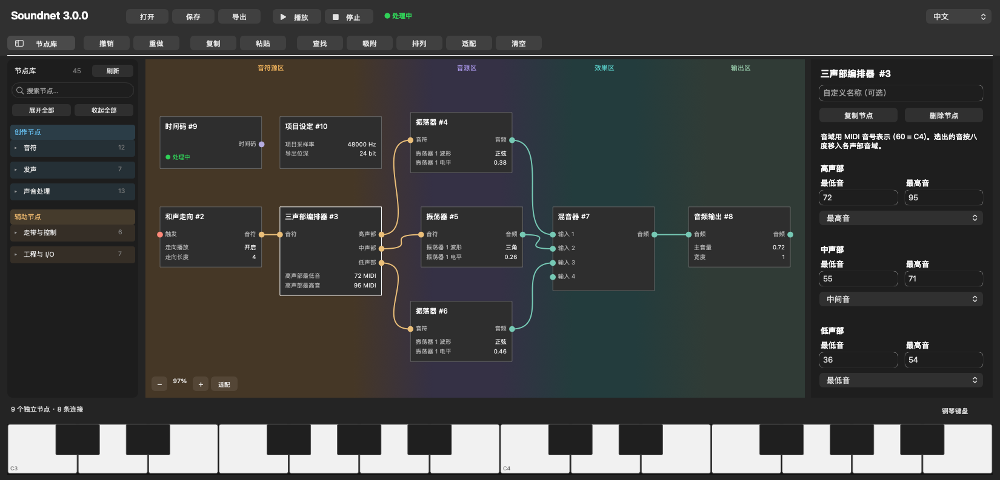

# Soundnet

简体中文 · [English](README.md)

Soundnet 是一个原生 macOS 音乐节点工具。可以在画布上把音符、音源和效果器接成一条声音链，把 DAW 的音频接进来处理，也可以用触发器安排片段何时开始和停止。同一工程可以在独立 App 或 Audio Unit v2 乐器插件里打开。



*图中是重新摆放在当前画布上的[三声部编配示例](examples/three-voice-arrangement.v4.json)。*

## 先试一个工程

1. 在 Soundnet 工具条点「打开」，载入[循环三次，再等待](examples/three-loops-then-wait.json)。
2. 点「播放」。第一个 MIDI 片段循环三次后停止，再等一秒触发第二个片段。点「停止」或按 **⌘.** 停止全图。
3. 从左侧节点库拖一个节点到画布。按住输出圆点拖出连线，在匹配的输入圆点松手即可连接。

想试声音处理，可以打开[音频片段与压缩器](examples/audio-clip-compressor.json)。想用 MIDI 演奏，可以试[拨弦采样器](examples/sampler-pluck.json)；也可以打开[MIDI 片段转 MIDI 输出](examples/clip-to-midi.json)。每个工程的启动方式见[示例说明](examples/README.md)。

## 在画布上搭建

节点库把**音符、发声、声音处理**归为创作节点，把**走带与控制、工程与 I/O**归为辅助节点，两组用不同背景区分。支持中英文搜索，可单击插入，也可拖到画布。

画布沿信号方向分为**音符源区、音源区、效果区、输出区**。颜色横向渐变，分界随节点分布调整，节点在各区内可以自由摆放。从节点库拖入新节点时，目标区可以先扩张，相邻区域会带着节点和连线横向让位。松手会一起提交插入和让位。按 **Esc** 可以取消，放下后按一次 **⌘Z** 可以一起撤回。画布提示空间不足时，可按住 **Shift** 放置来扩大让位范围。

拖线时线尾跟随鼠标，并吸附到匹配的输入。节点卡片显示主要参数，载入音频素材的节点还可以显示波形。选中节点后，可在右侧编辑完整参数。

## 创作、演奏与导出

- **编配音符。** 在钢琴卷帘编辑 MIDI 音符和控制器事件，搭建和弦进行，拆分三声部，也可以把 MIDI 送到外部乐器。
- **搭建音源与效果。** 用振荡器或采样器发声，将立体声音频送入效果器。用触发器安排循环、等待与条件播放。时间码提供共享的时间基准，需要节奏的节点各自设置。
- **接入 DAW。** 独立版使用「项目设定」选定的音频设备。AU 插件接收宿主乐器轨的 MIDI 和侧链音频，并把立体声送回该轨。
- **录制与导出。** 可以实时录制输入或输出，也可离线导出立体声 WAV、分轨 WAV 和标准 MIDI 文件。
- **本地生成。** 可选的 YuE2 和 ACE-Step 节点调用本地安装的 audio.cpp CLI。生成版本可以试听并随工程保存。YuE2 还可将生成的 ABC 乐谱转换为可编辑的 MIDI 片段。

工程保存为 v6 JSON。移动或备份工程时，若有同名的 `.assets` 文件夹，请和 JSON 一起携带。

## 构建与安装

Soundnet 3.0.0 支持 macOS 13 及以上，覆盖 Apple Silicon 与 Intel。源码构建需要支持 C++23 的 Xcode Command Line Tools。

```sh
./build-all.sh build/release
./scripts/package-app.sh build/release
./scripts/package-release.sh build/release
```

独立 App、AU 插件和节点 SDK 会生成到 `build/release/`。打包脚本在 `build/` 生成独立版安装包和 App + AU 的 ZIP。本地二进制采用临时签名，安装包未签名，产物未经 Apple 公证。

安装 AU 时，将 `Soundnet.component` 放入 `~/Library/Audio/Plug-Ins/Components/`，再重新打开宿主。在 Logic Pro 的软件乐器轨选择「AU Instruments → Soundnet → Soundnet」。Soundnet 与早期 Ternary 共用插件标识，安装其中一份即可。

```sh
app=build/release/Soundnet.app/Contents/MacOS/Soundnet
"$app" --validate examples/three-voice-arrangement.v4.json
"$app" --export examples/three-loops-then-wait.json output.wav 8
./scripts/test-all.sh build/tests
"$app" --open examples/three-voice-arrangement.v4.json
```

## 开发节点

Soundnet 使用 SDK 2 和节点包 ABI 2。节点源码放在 `nodes/<slug>/`，可以独立构建为 `.soundnode` 包。将兼容的包放入 `~/Library/Application Support/Soundnet/Nodes`，再点击节点库「刷新」。同 key 的用户包可覆盖内置包，普通节点更新无需重新构建宿主。

开发从 [AGENTS.md](AGENTS.md)、[项目宪法](docs/项目宪法.md)和[编写新节点](docs/编写新节点.md)开始。操作细节见[中文使用说明](docs/使用说明.txt)，版本历史见[更新日志](CHANGELOG.md)，发布验证及范围见 [3.0.0 基础验收](docs/3.0.0-基础验收.md)。

## 致谢与许可证

感谢 [hehongze88@gmail.com](mailto:hehongze88@gmail.com) 构建合成器节点的架设、调制与声音逻辑，以及高、中、低声部的声音映射相关代码。该贡献由 Santzhm186 提交到 Soundnet。

Soundnet 自有代码采用 [MIT 许可证](LICENSE)。随项目提供的 Apple AudioUnitSDK 保留原有的 [Apache-2.0 许可证](au/vendor/LICENSE.txt)。详见 [NOTICE](NOTICE)。
