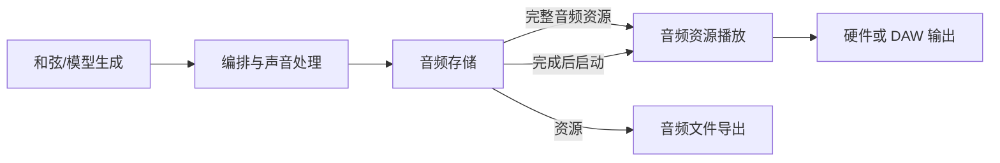

> 历史讨论稿，已由 2026-11-09 的 [项目宪法](项目宪法.md) 和 [2.9.1 实现映射](节点与连接标准-实现映射.md) 替代。本文保留原始讨论；其中独立节奏节点、全局节奏与旧工程兼容目标不再是当前要求。开发请先读取项目宪法。

# Soundnet 节点与连接标准及全局运行规范

| 项目 | 内容 |
| --- | --- |
| 文档版本 | 0.3 完整方案草案：依赖驱动工作流、可选时间域与结果存储 |
| 修订日期 | 2026-11-09 |
| 代码参考基线 | Soundnet 2.79.0，build 85，main `9c2f01f` |
| 实现状态 | 本文定义后续实现目标，当前软件能力以代码和对应版本说明为准 |
| 本轮交付 | 完整标准文档 |
| 后续实现范围 | 平台契约、全局时间与采样设置、现有注册节点全量迁移、旧工程兼容、异步任务接口、编辑器与导出入口 |

Soundnet 以“输入 → 节点处理 → 输出”为工作流基础，按数据与事件的依赖关系组织执行。输入就绪的节点进行处理，结果就绪后供下游使用。普通数据计算可以没有音乐位置、节拍或持续时间；音频流、播放、定点触发等行为按需使用时间服务。平台负责依赖调度、资源、可选时间域、工程与宿主交互，节点负责自身声明的处理行为。常规节点修改应局限于该节点所属模块，其他模块通过稳定接口继续工作。

本次修订保留节点版本、稳定标识及兼容规则，并明确区分依赖执行、实际计算耗时和内容时间。新增缓冲播放、完整渲染后试听，以及独立的渲染任务、音频存储与资源播放节点。后续开发按完整范围组织，文内工作顺序用于安排依赖和回退。

本文的“必须”表示拟采用的契约要求，“建议默认”表示本次方案选择。用户明确提出的方向包括完成整体标准、支持节点独立演进、提供稳定的系统备用时间来源，以及规定采样率等全局设置。具体默认数值列于第 14 节。

## 1 设计目标与完成条件

新增一个常规节点，只需添加所属模块和注册声明，即可在节点库与右键菜单中出现，完成参数编辑、接线、按能力执行、保存和恢复。实时流处理与离线渲染按节点声明的执行能力提供。

节点模块可以包含描述符、运行内核、状态迁移、预设、资源与专用界面。一个模块可由多个文件组成。新增模块应通过平台公开的扩展接口接入，已有节点的行为变更由自身版本承担。

来源或职责不同的节点独立注册：虚拟键盘 MIDI 输入、DAW MIDI 输入、MIDI Clip 输入、系统时钟、DAW 时钟、节奏速度、硬件音频输出和 DAW 音频输出各有自己的类型与端口。预制和自定义内容可共享资源结构，提供独立的内容生成入口。所有公开节点进入右键插入菜单，同类节点允许重复创建。输入、处理、输出及逻辑控制均按这套接口扩展。

平台必须覆盖以下结果。

- 节点实例具有独立配置、运行状态与素材引用。
- 节点升级能够解释旧工程中的参数、端口和保存状态。
- 无时间计算、定时事件和音频流各有明确契约；相关节点通过声明的时间域与格式映射协作。
- 实时音频、离线计算与异步任务使用明确的执行边界。
- 现有注册节点全部纳入新接口，旧数值类型标识 1–46 保留映射。
- 缺失节点、素材或模型时，工程能够保留内容并说明受影响的部分。

## 2 契约分层与版本

| 层次 | 负责内容 | 演进规则 |
| --- | --- | --- |
| 工程与信号协议 | 文件结构、稳定标识、信号含义、连接规则、持久化时间表示 | 每个已发布主版本保持原有含义，语义变化通过新版本及迁移器表达 |
| 节点 SDK | 描述符、运行接口、资源接口、时间上下文、线程约定 | 通过 SDK 版本及适配层演进 |
| 节点模块 | DSP、音符处理、任务执行、预设、专用界面 | 模块自行版本化，遵循其声明的行为与状态契约 |

文档 0.x 为试行方案。通过不同类型节点贯通实际开发入口后，再发布契约 1.0。128 帧处理块、固定输入数量和当前立体声布局作为实现条件记录，后续能力可通过版本化声明扩展。

下列版本各自保存。

| 字段 | 含义 |
| --- | --- |
| `version` | 工程文件格式版本，新格式为 4 |
| `nodeKey` | 节点类型的稳定名称，例如 `soundnet.voice-arranger` |
| `nodeVersion` | 节点行为版本，包括默认值、参数解释和算法行为 |
| `stateVersion` | 节点持久化内容的结构版本 |
| `sdkVersion` | 节点调用平台接口的版本 |
| `signalVersion` | 端口负载的结构与语义版本 |

工程记录实际使用的节点版本。平台按该版本解析，兼容适配器负责支持旧版本。改变默认音域、音高选择、延迟算法或参数含义时，模块必须说明行为版本的变化。跨行为版本升级生成可预览、可撤销的工程迁移事务。

兼容性分别声明为工程可读取、内容可迁移、音乐行为可保持、确定性输出可复现。逐样本一致的适用条件须包含算法版本、素材、随机种子、采样率、起始状态及执行环境。随机节点保存种子，外部输入和模型结果通过录制或固化素材获得可重复输入。

## 3 稳定标识与工程保存

每个节点类型使用带命名空间的 `nodeKey`，每个实例使用工程内唯一的 `instanceId`。输入端口、输出端口和参数均使用节点类型内稳定的 ID。显示名称、界面顺序及参数分组可以单独修改。

连线按稳定端口 ID 保存，例如 `high`、`middle`、`low`。运行计划在编译阶段把它们映射为高效的整数索引。删除的类型、端口与参数 ID 进入保留表。

旧工程中的数值类型、端口索引和参数 ID 由显式迁移表映射。迁移器把旧版默认值固化为明确配置，包括旧工程实际使用的 BPM、波形、音域及播放行为。新工程默认值只作用于新建工程。

持久化数据分为三类。

- 配置保存参数、连接、时间设置、节点行为版本及局部覆盖。
- 音乐内容保存 MIDI、采样素材、模型结果、资源引用与编辑数据。
- 临时运行状态包括当前按键、包络进度、延迟缓冲、计数器与临时任务状态。普通工程保存不直接写入这类状态，恢复时采用节点声明的可重建起点；实时快照由单独能力提供。

未知字段读写往返时原样保留，平台只解释支持的字段。未知节点、未来版本节点及缺失资源显示占位，保存原始记录及连线。受影响的输出停用或按节点声明的安全策略处理，下游已发出的 MIDI 音符必须收音。其余可运行子图可以继续运行，并显示缺失依赖状态。

工程文件采用临时文件写入后原子替换。保存、自动保存、撤销、AU 工程恢复与 CLI 导入采用同一数据模型。工程加载先完成解析与迁移，再发布完整运行计划。完整性检查失败时保留当前可用工程。

## 4 NodeSpec 节点描述符

`NodeSpec` 是节点身份、端口、参数、资源与运行能力的统一来源。节点库、右键菜单、普通检查器、连接规则、保存恢复与执行计划均从它派生。

| 字段 | 要求 |
| --- | --- |
| 身份 | `nodeKey`、`nodeVersion`、`sdkVersion`、`stateVersion`、旧版映射 |
| 展示 | 名称、分类、说明、可见性、端口与参数的显示顺序 |
| 输入与输出 | 稳定端口 ID、信号类型及版本、角色、适用的通道布局、多源策略、可选时间域 |
| 参数 | 稳定 ID、类型、单位、默认值、值域、枚举、离散性、平滑方式、自动化能力 |
| 资源 | 允许的素材类型、内容版本、大小与内存预算 |
| 执行 | 数据计算、后台/外部任务、实时流处理等能力；输入就绪条件、触发方式、确定性条件与资源预算 |
| 时间语义 | 执行无需时间上下文、内容内相对时间、定时事件或连续流；所需时间域、范围与映射 |
| 状态 | 配置迁移、内容迁移、复位、旁通、停止及尾音规则 |
| 能力 | 多输出、侧链、时钟提供、输出汇总、素材消费、异步任务、快照、完整结果发布及分块结果发布等 |
| 工厂 | 运行内核工厂、可选界面工厂、迁移器 |
| 延迟 | 固定或可变延迟的声明、尾音信息、反馈最小延迟 |

能力标志用于发现支持的功能，具体含义由对应结构描述。输入端口角色只标明用途，每个内核按稳定端口 ID 读取输入。多输出节点为各出口分别持有数据，并按需维护各自音符状态。

普通参数界面自动生成。波形编辑、钢琴卷帘、模型配置等界面通过统一事务接口提交修改，获得撤销、自动保存及宿主恢复能力。内核支持无界面运行。

## 5 信号与连接规则

首版定义下列信号类别。新信号使用命名空间及版本注册，并声明兼容条件。

| 类别 | 负载与用途 |
| --- | --- |
| Audio | 带通道布局、有效帧数、采样率上下文的音频缓冲 |
| MIDI | 带通道及消息数据的事件；接入定时流时附采样位置，完整 Clip 使用 Resource 保存内部相对时间 |
| Trigger | 带事件种类、执行批次和顺序号的因果事件，例如开始、停止、完成；音乐时间按需附加 |
| Clock | 所属时间域的位置、推进状态及映射；BPM、拍号作为可选音乐定位配置 |
| Control | 带单位的数值或自动化数据；普通值无需时间，定时变化声明时间域 |
| Resource | 带内容类型、版本、内容标识的不可变资源句柄，例如 Clip、音频、模型结果 |
| TaskEvent | 异步任务完成、失败、取消及结果引用 |

连接两端必须具有兼容的信号、版本和通道声明。转换通过显式节点完成，TaskEvent 也可以经转换节点产生 Trigger。

- 每条连接由源实例、源端口、目标实例、目标端口唯一确定，重复连接应被拒绝。
- 普通输入接受一个来源。触发输入可以声明多源，音频和 MIDI 合并通过混音或合并节点表达。
- 扇出共享只读输入，同一上游可以连接多个下游。
- 同一轮求值中的直接依赖构成有向无环图。无依赖的分支可独立执行。
- 数据迭代通过显式循环节点建立下一轮输入，声明状态、终止条件或次数、预算与取消行为，每轮交回调度器。
- 定时事件和音频流的反馈必须经过声明了正时间延迟的边界；普通数据迭代不强制增加音乐时间。
- 节点执行前由运行计划检查端口数量、缓冲布局及资源预算，边界访问采用有界索引。
- 缺省输入由描述符说明。处理节点可接收静音或空事件，噪声、节拍器等生成节点按自己的运行条件输出。

节点类型不设置固定数量或数值 ID 上界，同类实例不设置单独配额。首版可沿用 4096 个节点、16384 条连线作为默认工程资源预算，通过显式配置扩展。实际可实时运行的规模还受总内存、事件预算及处理时间约束，超出预算时平台在发布计划前给出具体原因。

## 6 节点执行、依赖与状态契约

### 6.1 按输入依赖执行

节点声明一次执行需要哪些输入、参数和资源，支持“显式触发”“输入版本改变后执行”或“被输出任务请求时执行”等方式。系统只在对应条件满足后安排执行。耗时通过诊断信息记录，结果保持自己的内容语义。

例如“和弦生成 → 三声部分配”计算用了两秒，输出仍是一组音符或包含自身位置的 MIDI Clip。只有用户连接音乐等待或定位节点时，才在内容中加入相应时间关系。

一次执行使用不可变输入快照，携带 `runId`、实例 ID、输入版本、图版本及取消标记。交互计算可以声明跟随最新输入；明确提交的渲染任务默认固定本次输入快照，后续编辑产生新的任务版本。汇合节点声明等待全部输入、任一输入或指定批次；来自不同执行批次的结果不能无说明地拼接。相同结果向多个下游共享只读资源，各下游独立持有运行状态。

结果就绪事件表达“此结果可供依赖者使用”。它可以立即推动下游数据计算；进入定时流时，必须由桥接或播放节点指定生效位置。系统单调时间记录的完成时刻不自动成为作品的音乐时刻。

数据循环采用轮次 ID、迭代状态与明确终止条件。重复处理三次可以在同一内容位置完成三轮计算；计数节点统计收到的事件，不要求三拍或三段休止。持续循环每轮让出执行权，接受预算限制和取消，避免无限递归。

### 6.2 按能力提供执行接口

每个实例拥有独立内核和状态，生命周期由执行能力决定。同一图中实例同时用于实时播放和后台渲染时，各会话使用独立运行状态；仅不可变配置和资源可以共享。

| 能力 | 生命周期与上下文 |
| --- | --- |
| 数据处理 | 输入快照 → evaluate → 发布结果；不要求采样率、BPM 或工程播放位置 |
| 后台或外部任务 | submit → 等待/运行 → 完成、失败或取消；按依赖发布结果 |
| 定时流处理 | prepare → 发布配置 → process → reset/停用 → 非实时回收；获得采样率、最大块长、总线与时间域 |
| 播放或渲染会话 | 建立范围及时间映射 → 请求所需结果/流区间 → 输出、存储或终止 |

描述符可以组合这些能力，通过各自的公共上下文工作。数据节点无需实现逐音频块调用；同一类定时内核在实时和离线会话中复用处理逻辑。

实时 `process` 读取声明的输入，写入专属输出。实时路径须有界，资源分配、文件访问、网络请求和阻塞等待由非实时服务承担。后台执行也不得直接修改渲染线程拥有的状态。

参数自动化事件可以具有块内采样位置，连续参数按声明的平滑规则变化。普通配置在所属执行边界生效：数据任务采用输入快照，实时流采用处理块边界。拓扑重建、素材解码和复杂状态转换在后台完成，再完整发布。

### 6.3 状态与命令作用范围

| 操作 | 必须明确的结果 |
| --- | --- |
| 局部 Stop | 停止指定播放或流节点，收回受影响音符并按声明处理尾音 |
| Transport Stop | 停止选定时间域的走带，不自动取消无时间依赖的数据计算 |
| Cancel Run | 取消指定工作流执行或任务，阻止其后续结果提交；已完成资源保留 |
| Panic | 在指定声音路径立即收音，清理待播放事件与效果状态 |
| Seek | 更新指定时间域代次，重建目标位置所需状态，清除依赖旧映射的调度 |
| Reset | 重置指定实例或会话的计数、随机序列等可重建状态 |
| 删除或换线 | 取消受影响依赖执行，收回该路径音符，安全释放资源 |
| 素材替换 | 新资源准备完成后原子切换，旧引用在使用结束后回收 |
| Bypass | 使用描述符的逐输出映射及状态策略，多输出节点须分别定义 |

所有生命周期回调携带作用范围与原因。普通 `Trigger.Stop` 只作用于收到它的节点；工程停止控制节点与宿主入口向指定时间域提交 `TransportCommand.Stop`。工作流开始、取消和播放开始、停止使用独立控制节点。

旁通需声明直通来源、尾音与内部状态的继续或复位方式。切换时处理干湿增益过渡和音符配对。默认旁通保持相同处理延迟；若声明旁通改变延迟，则随新的补偿计划统一切换。无适当旁通语义的节点隐藏该功能。

## 7 可选时间域、时间推进与系统备用时钟

每个工程始终拥有 `ProjectTimeService`，提供稳定系统时钟、时间域注册与转换服务。普通数据流无需读取它。播放器、实时输出、渲染任务或明确的时间控制节点按需创建和使用时间域，可以在同一工程中拥有各自的起点与进度。

用户提出的“控制时间流速”在本标准中由时间推进器承担：管理相关内容的推进、暂停、定位、步进及声明支持的速率。时间码、小节和拍作为定位或交换方式。节点必须先声明是否需要内容时间，平台才向它提供对应上下文。

| 信息 | 语义 | 适用范围 |
| --- | --- | --- |
| 因果顺序 | 输入就绪、执行轮次与结果依赖 | 所有工作流；本身不表示音乐时长 |
| 内容时间 | 音频或 MIDI 内部位置，可使用本地零点或指定时间域 | Clip、流处理、渲染、播放与定点事件 |
| 计算进度 | 已完成输出，以及流任务已就绪的区间 | 调度、缓存与界面状态；无时间任务不需要区间 |
| 播放进度 | 声卡或宿主正在消费的内容位置 | 硬件/DAW 播放；与提前计算进度分开 |
| 单调系统时间 | 持续递增的现实计时来源 | 超时、耗时、设备映射与无音频设备的定时调度 |

系统日期、时区和手动校时只用于文件与日志显示。音频设备按实际输出帧消费声音，后台计算可以领先或落后于播放。离线渲染按依赖就绪情况计算内容区间，计算一秒声音可以花费任意实际时长；音频内容时长保持一秒。

有时间的运行会话使用 `timeDomainId`、代次、64 位帧位置及块内采样偏移。持久化绝对时间以有理秒表示，音乐位置以有理拍表示。无时间的数据和事件可以省略这些字段，保留执行批次与依赖信息。跨时间域连接须通过明确映射，不能因名称相同就认为两者同步。

### 7.1 时钟来源与备用策略

独立播放会话建议默认使用系统时间源，AU 的宿主播放域建议默认使用 DAW 时间源。工程保存默认策略，各会话显示实际来源和同步状态；未开启播放的普通工作流不因缺少宿主时钟而等待。

| 状态 | 行为 |
| --- | --- |
| System | 内部时间服务按所选播放策略推进 |
| Locked | 采用有效宿主时间及走带状态 |
| Holdover | 宿主时间短暂缺失，按最近有效位置与实际处理帧连续推算 |
| Fallback | 宿主时间持续缺失，切入内部时间服务或按策略停止 |
| AwaitingSource | 需要外部时间的会话等待来源，保持停止 |

建议宿主时间缺失容限为累计 0.5 秒实际回调处理时长，随后按会话保存的 `continueInternal` 或 `stop` 策略执行。继续内部运行只延续此前已处于播放中的时间线。DAW 明确报告停止属于有效状态，备用时钟保持停止。

没有宿主音频回调时，AU 的音频输出暂停。后台任务可继续计算，下一次回调根据宿主当前位置重新建立播放映射。恢复时若发生跳变，只对依赖该时间域的调度执行 Seek，原始资源和无时间任务保持自身状态。

采样率改变、定位、会话替换时更新受影响时间映射的代次。输入或参数修改使计算结果过期时，采用输入版本与执行代次判断；无时间任务不绑定无关播放器的位置。

### 7.2 时间推进与音乐定位

时间推进器的推进条件由会话决定：实时播放满足设备或宿主的输出截止时间；缓冲试听消费已经就绪的连续区间；离线任务等待依赖就绪后计算下一区间。CPU 负载和模型等待不自动改变音乐速度，也不自动在作品中加入休止。

需要主动改变内容推进倍率时，由明确的速率参数表达。默认倍率为 1，暂停使用会话状态。音频变速播放是否联动音高、是否采用保持音高的时间伸缩，由专门节点声明；改变处理采样率通过格式适配保持原有内容时长。首版可只支持正常速率与暂停/继续，其他能力通过描述符扩展。

需要音乐定位的时间域保存 BPM、拍号和速度图。内部音乐拍单位为四分音符拍，界面的小节与拍从 1 开始编号，拍长度按拍号解释。“第 18 小节第 2 拍触发”由独立的位置触发节点保存其音乐坐标，并按指定时间域映射到实际事件位置。音乐结构变更后重新映射；普通和弦计算节点无需该坐标。

局部节奏速度节点可以定义分支 BPM、分频与相位。分支加入共同播放或混音时，明确映射到目标会话时间；分支独立计算不必共享同一个播放游标。

音乐等待节点在内容时间中加入按拍或按秒的间隔。现实等待节点使用单调系统时间延后执行，等待依赖完成由汇合或任务节点表达。这三种职责使用独立节点类型。系统计数节点只统计指定事件，循环次数与小节数分别记录。

同一采样位置收到互相冲突的同域走带命令时，停止优先于播放，定位按稳定顺序处理。音乐循环边界具有循环次数标识，各节点声明跨循环的音符、尾音与计数行为；默认音符在边界收音并由新一轮重新触发，效果尾音可延续。无时间的数据迭代遵循第 6.1 节。

### 7.3 时间码格式

系统时间码节点读取指定时间域，提供 `HH:MM:SS:FF`、秒、采样位置及可用的小节拍位。帧率以分子、分母保存，同时保存起始偏移与 drop-frame 标记。显示舍入只作用于显示与交换边界，音频事件使用自身精度。

首版定义 24、25、30 fps 非丢帧格式，建议默认 30 fps NDF、起始偏移为零。分数帧率及丢帧格式通过独立格式能力扩展，导入不支持格式时保留配置并提示。

外部 MTC、LTC 等时间码接收与发送各作为独立节点，通过同步接口加入。系统备用时钟由常驻服务提供；放置时间码显示或交换节点是可选操作。

## 8 因果调度、定时事件与延迟

### 8.1 数据与任务调度

工作流调度器根据依赖和输入版本安排节点。完成顺序可与最终内容顺序不同，汇合节点按执行批次收齐所声明的结果。不同 CPU 线程无须在同一现实瞬间完成计算。

对于需要同步输出的多个定时分支，调度器按相同时间域、版本和内容区间收齐结果，再发布该区间。无时间的数据汇合只检查依赖与批次。已确认的空结果或静音可视为就绪，尚未返回的输入不能被当作空结果。

只有共享依赖或明确属于同一同步输出组的分支相互等待，独立工作流可以继续运行。汇合条件须声明等待全部、选择一支或按策略忽略失败，不能以全图所有节点完成作为默认门槛。

### 8.2 定时流中的事件

定时事件携带时间域、代次、目标帧、块内采样偏移、事件种类及稳定顺序号。同域普通处理链保留原始事件位置，跨域或主动重定时使用明确映射。

调度器在当前音频块内按时间、依赖顺序与稳定顺序号处理事件。相同采样位置、同一 MIDI 通道与音高的 Note Off 先于重新触发的 Note On。

采用有界队列避免递归重入。音乐等待、显式延迟或定时反馈边界才向未来移动内容位置。定时反馈回路必须具有最小正延迟；无时间的循环按第 6.1 节建立下一轮执行。超出每块事件预算时报告节点与路径，并保证已发音符能够释放。

### 8.3 延迟的归属

- `processingLatencyFrames` 表示过采样滤波、分块算法等引入的处理延迟，按对应会话实际采样率报告，用于路径对齐和宿主延迟报告。
- `musicalDelay` 表示 Delay、MIDI Echo 或音乐等待节点有意加入的时间关系，保留在内容中。
- `computeDuration` 表示数据或任务的实际计算耗时，作为运行状态显示；它不直接参与音乐延迟补偿。
- 预缓冲等待属于播放策略，设备队列属于 I/O 延迟，两者分别显示。向宿主报告固定的已知处理/流缓冲延迟，不能用模型尚未完成的时长作为可补偿保证。

处理延迟变化在运行计划边界统一更新。受影响的待发事件重新映射，失效事件取消并收音；已经输出的事件保持既有结果。反馈内部延迟保持显式，补偿只应用于可计算的前馈汇合路径。

## 9 采样与音频基础契约

### 9.1 音频缓冲和素材

同一音频会话内的实时总线使用 Float32、按通道分离的缓冲布局，并携带有效帧数和声明的通道布局。内部浮点样本允许超过标称满幅，限幅由显式处理或最终整数编码策略完成。非有限样本必须在素材导入与节点输出边界报告并隔离。

素材记录原始采样率、通道数、帧数、内容标识、格式与来源信息。素材原始内容以不可变资源管理。重采样、声道转换和采样器音高变换各自有明确的处理职责。

音频片段的开始和结束位置以原始素材帧为基准，区间采用左闭右开规则，必须满足开始小于结束。循环、交叉淡化与包络声明单位，界面毫秒值在进入内核时统一换算。改变设备或渲染采样率时保持素材持续时间和预期音高。

公共素材服务提供解码、缓存和带版本的重采样器，节点通过资源句柄使用素材。处理质量与转换延迟应可查询。内部过采样由节点声明倍率、CPU 需求与延迟，并在节点边界转换回当前工程处理格式。

### 9.2 采样率的归属

| 字段 | 归属与含义 |
| --- | --- |
| 工程期望采样率 | 随工程保存，作为独立运行和默认导出的偏好 |
| 实际处理采样率 | 当前音频会话使用的采样率，该会话的音频节点统一读取 |
| 设备采样率 | 声卡的实际 I/O 格式，由设备接口报告 |
| 宿主采样率 | AU 所在宿主提供的处理格式 |
| 素材采样率 | 素材自身元数据，保留原值 |
| 导出采样率 | 单次离线导出的目标格式，写入导出任务记录 |

独立 App 提供“跟随设备”和“请求指定采样率”两种工程策略。建议新工程请求 48 kHz，提供 44.1、48、88.2、96、176.4、192 kHz 选项。设备适配器报告协商结果，无法满足时采用实际可用格式并显示差异。输入与输出设备存在差异时，在设备边界进行转换。

实际处理采样率按每个音频执行会话的运行模式唯一确定：独立实时模式采用输出设备协商成功的采样率；只有输入设备的录制模式采用输入设备实际值；AU 采用宿主格式；离线任务采用导出任务指定值。该会话中的音频内核、帧时间与处理延迟换算使用此值。无音频计算不要求采样率。纯 MIDI 定时输出会话可以使用工程期望采样率作为高精度时间戳换算时基，界面标明没有音频设备渲染；普通 MIDI 数据转换不需要此配置。

独立输入设备在设备边界转换到实际处理采样率，多设备时钟漂移由设备适配器持续校正。首版不额外提供固定工程处理率加输出转换的隐藏模式。素材在资源边界适配实际处理采样率，界面同时显示设备、宿主与处理格式的来源。

首版建议支持 8–192 kHz 的处理范围，具体声卡可用值由设备报告。节点声明支持范围，在准备计划时检查。工程采样率与导出采样率可以分别保存。

改变实际采样率采用受控重配置流程。保存受影响会话的内容位置，收回活动音符，准备新节点配置与转换缓存，在安全边界切换并增加受影响时间域的代次。节点声明可迁移状态，无法迁移的临时状态按其复位规则重建。

### 9.3 缓冲区与输出格式

设备 I/O 缓冲大小作为本机偏好保存，显示请求值与实际值。建议默认请求 256 帧。AU 使用宿主提供的块大小。

音频流内核准备时获得最大块长，每次处理获得实际帧数。平台可在内部切块，128 帧可作为首版实现选择。此类内核必须支持尾块与不同实际块长，定时会话的事件位置由时间戳决定。

离线导出支持 16 位整数、24 位整数与 32 位浮点 WAV。建议默认 24 位整数；已存音频默认采用资源原采样率，需要重新渲染时继承来源会话的实际采样率，无来源会话时采用工程期望值。整数编码的削波与抖动策略明确显示，建议整数导出启用 TPDF 抖动，浮点导出关闭抖动。抖动种子随导出任务记录。

实时录制保存实际输入或输出采样率。多声道布局由端口声明和设备能力协商，首版默认立体声。显式声道转换节点默认将单声道复制到左右声道，将立体声按 `(L + R) / 2` 混合为单声道；其他混合矩阵作为参数保存。图内连接不暗中增加转换，设备边界的适配方式在 I/O 状态中显示。

### 9.4 按结果用途选择执行与试听方式

普通工作流以请求的输出就绪作为完成条件。音频结果可以通过以下方式使用，同一工程可以并存不同会话。

| 方式 | 执行与输出规则 | 适用情况 |
| --- | --- | --- |
| 实时流 | 按声卡或宿主截止时间提供音频，仅执行满足实时能力的节点 | 键盘演奏、现场音频、轻量效果 |
| 缓冲试听 | 后台提前计算，消费已经完成且连续的音频区间 | 素材已知、存在短时计算波动的子图 |
| 完整处理后试听 | 请求的有限音频结果全部完成并存储，再启动播放 | 重计算、模型生成、可接受预先等待的创作 |

节点数量本身不能决定是否实时，调度器依据依赖、执行能力、耗时和资源预算安排。普通数据计算和后台模型可以与实时播放器并存，通过完整资源或已声明的分块边界交换结果。

预计算需要已知输入。实时键盘、麦克风或未来宿主输入先通过录制节点固化，才能参与相应范围的离线生成；缺失未来输入的子图不能宣称已预渲染完成。

### 9.5 音频缓冲节点与同步播放

独立音频缓冲节点通过有界队列承接音频生产与消费。描述符声明容量、启动水位、当前连续就绪区间、格式、延迟、满空处理与失效策略。后台任务写入或释放队列，实时输出只读取已发布数据。

- 开始缓冲试听前，先满足启动水位；将同一同步输出组的必要分支在同一内容区间对齐，再统一启动。
- 后台生产者遇到容量上限时暂停提交并等待消费，或按声明使用磁盘分块缓存；实时输入不能阻塞，必须报告丢帧或录制失败。
- 缓冲不足时，独立试听可进入“缓冲中”，将试听内容位置停在就绪边界，声卡持续获得静音块。恢复时从同一内容位置继续；同步组一起停续，处理音符释放与过渡。
- AU 实时输出继续跟随宿主位置，按时返回可用音频或规定的静音，报告欠载并舍弃已错过播放位置的结果。插件不能等待慢节点而阻塞宿主回调。
- 可预报的固定流缓冲延迟参与宿主延迟报告；“先算好再播放”的实际等待时长单独显示。

缓冲可以吸收短时波动。持续生产音频的速度低于播放消耗时，有限缓冲最终耗尽，需增加预先完成的范围或改用完整处理后试听。缓冲不足不能暗中降低音乐速度来掩盖问题。

设备 I/O 缓冲、节点间音频队列、可复用计算缓存分别管理。前者服务声卡交付，音频队列服务当前生产消费，计算缓存按版本复用结果；界面分别显示容量、占用与状态。

### 9.6 渲染任务、音频存储与播放节点

各职责使用独立节点类型，全部进入右键菜单。

| 节点 | 职责与最小端口 |
| --- | --- |
| 渲染任务 | `start/cancel` 触发；提交指定输出目标与输入快照的有限音频任务，输出状态与总完成事件 |
| 音频缓冲 | `audioIn → audioOut`；有界流队列，并输出水位/欠载状态 |
| 音频存储 | `audio` 与 `control` 输入；写入会话结果，输出完整 `resource`、`completed` 触发及状态 |
| 音频资源保存 | `resource` 与 `save` 输入；将已有完整音频持久化到工程资源库，输出资源引用与完成事件 |
| 音频资源播放 | `resource` 与 `control` 输入；读取完整音频，输出定时 `audio` |
| 音频文件导出 | `resource` 与 `export` 触发输入；按指定编码写入交付文件，输出文件资源与完成状态 |
| 依赖汇合 | 按执行批次等待声明的多个结果，再输出就绪事件 |

渲染任务通过公共调度服务选择音频存储等目标节点，目标引用使用稳定实例 ID/任务句柄。调度器解析其上游依赖，内核不直接读取其他节点的内部对象。普通生成或转换工作流无需额外渲染任务。模型已返回完整 AudioResource 时，可直接连接音频资源保存、播放或文件导出节点，资源保存无需先播放一遍。音频流写入与完整资源保存采用独立节点类型，共享底层资源服务。

音频存储节点的契约如下。

1. 每次写入建立独立 `captureId`/`runId`，接收明确的开始、结束或取消命令，固定采样率、声道、内容位置与容量上限。离线渲染须事先声明有限内容范围，现场录制可由结束事件收尾，但仍需容量上限。
2. Audio 块按会话、格式和连续位置写入暂存资源。节点跟踪已接收范围，缺块、重复块和超限作为显式状态处理。实时线程只投递有界缓冲，后台线程写磁盘。
3. 收尾成功后，原子发布不可变 AudioResource，包含内容标识、采样率、声道、帧数及生成版本，再投递一次 `completed` 触发。完成事件携带资源 ID 与执行批次；内容起止位置、实际完成时刻各用独立字段。
4. 新一轮处理期间保留上次完整结果。失败或取消不覆盖它。未完成文件不标为完整音频，也不自动启动试听；需要保留部分结果时必须显式标记不完整。
5. 默认使用工程管理的持久音频资源，建议 Float32 无损保存并包含在工程收集/迁移中。文件系统写入与空间预算由资源服务管理。内部存储完成不要求用户先选择交付文件；指定 WAV 位深等编码由独立导出节点负责。

内容结束点停止新事件并收回活动音符，随后按策略处理尾音。渲染任务保存最大尾音结束点，循环、持续振荡和反馈都必须有明确的本次任务边界。达到尾音上限时记录截尾策略，不能无限等待。

一次请求多个音频输出时，总完成事件在本批次所有必需结果都成功存储后触发。多个播放器从同一就绪批次建立共同播放起点，结果完成得较早的分支先等待。其他无关工作流的状态不影响此批次。



上图中的生成与编排可按依赖耗时执行，声音处理在任务给定范围内产生音频。存储完成后，资源播放节点才建立或加入播放时间域。若需要在 DAW 某拍启动，完成事件先进入指定时刻的播放桥接；已错过的目标按明确迟到策略处理。

### 9.7 缓存复用与结果保存

计算缓存由资源服务管理。普通数据缓存键包含节点行为版本、输入内容、参数、随机种子及相关依赖；有时间或音频的任务再加入内容范围、时间映射、初始状态、采样率、声道和尾音策略。画布位置、颜色等编辑外观不进入计算键。

输入或参数改变时，失效范围沿依赖传播，新计算使用新的版本。流缓存只公开对应版本的就绪区间。随机或外部服务结果只有在已固化、可追溯的条件下参与复用。

缓存失效表示旧结果不能直接代表新的输入。已经存储的音频仍是有效素材，可继续试听、导出或供其他节点使用；界面标记“来源已更新”。临时缓存允许按预算回收，用户保留的音频资源须持久保存。

## 10 全局设置与节点设置的关系

全局设置作为工程默认值保存，节点只读取自己声明需要的上下文。时间域、播放会话和渲染任务可以显式选择自己的设置。修改通过事务接口提交，只有定时生效的修改才要求时间位置。

| 保存位置 | 内容 |
| --- | --- |
| 工程 | 默认时钟策略、可选音乐定位设置、期望采样率、随机种子、试听策略、缓冲与存储预算 |
| 时间域/会话 | 时钟来源、音乐位置映射、播放位置、循环范围、速率、实际运行格式及尾音策略 |
| 本机偏好 | 设备 ID、设备缓冲偏好、MIDI 端口绑定、资源搜索路径 |
| 宿主运行上下文 | 实际采样率、实际块长、播放位置、宿主速度、宿主延迟要求 |
| 渲染/导出任务 | 输入快照、目标输出、有限范围、采样率、声道、位深、抖动、尾音、模型素材版本 |
| 节点实例 | 局部节奏覆盖、音域、音色、效果参数及独立资源引用 |

只有描述符声明允许覆盖的项目才能在节点中覆盖。界面同时显示继承来源和覆盖值。同一音频会话内的实际采样率、处理块长及位置由平台统一提供，普通数据节点可完全不依赖这些字段。

系统时钟、DAW 时钟、局部节奏速度保持独立节点类型。时间控制通过明确目标会话的播放、停止、定位节点表达，工作流另有执行与取消节点，读取工程设置也通过明确的读取节点暴露。图形编辑器提供全局设置面板以管理工程级内容。

## 11 模型及 API MCP 异步任务

模型和外部服务声明为后台计算或外部请求节点，通过任务服务提交输入快照。它们可以参与没有播放时间线的普通工作流。实时流只消费已经准备完成的结果。

任务记录至少包含工程 ID、`runId`、节点实例、请求 ID、输入版本、图版本、取消标记与资源预算。只有绑定定时行为的任务才附加时间域、代次与目标位置。状态包括排队、运行、完成、失败、取消与超时。

结果先成为不可变 MIDI Clip、音频、控制数据或其他资源，然后触发依赖者计算。无时间的“完成”事件携带结果引用和批次；实际开始/结束时刻用于诊断与超时，不能自动写进音乐内容。

结果接入播放时，桥接节点明确选择当前可播放位置、下一拍、下一小节或指定位置，并声明迟到策略。离线渲染中等待任务只增加计算耗时，结果仍放入原定内容位置。下一拍等策略只适用于拥有音乐定位的目标时间域。

Cancel Run 和删除执行目标会阻止相应任务提交。跟随最新输入的交互任务在参数或输入改变后失效；固定快照的渲染任务可继续完成原请求，结果记录其来源版本并标记后续编辑差异。播放 Stop 或 Seek 只影响绑定该播放会话的调度，普通生成任务可以继续。已失效结果可作为历史素材保留，重新入图须建立有效提交；自动试听需确认它仍属于当前试听请求。

离线任务按依赖等待，或使用事先固化的结果；缺失必需输入时显示等待/失败，不默默填成完整成功的作品。需要复现的内容保存结果、模型或服务版本、随机种子及输入内容标识。

API、MCP、音频、视频及外部程序的协议转换位于各自适配节点内。平台接收版本化的事件与资源。外部服务凭据属于本机配置，工程保存连接配置的引用。

后续完整实现范围包含异步任务、资源发布与播放桥接接口，以及可贯通该流程的示例任务节点。具体模型和 DAW 协议适配随各自节点模块增加。

## 12 运行失败与资源管理

节点通过结构化状态报告缺失资源、版本不兼容、输入错误、超时和资源预算耗尽。报告包含实例、端口或参数位置，编辑器可以定位到具体节点。

配置错误在计划发布前处理。实时路径出现异常数据时，隔离受影响输出、释放对应 MIDI 状态并向非实时状态通道上报。旁路或静音行为由节点声明，其他可运行子图继续执行。

资源按内容标识去重，定位信息单独保存。相同素材可以共享只读缓冲，播放位置和声音状态仍属于各实例。旧资源待渲染与任务引用释放后在非实时线程回收。

工程规模、内存预算、每块事件数量、后台任务并发数和输出声部数量均有明确上限。取消任务和关闭工程必须能终止后续提交，缓冲溢出后的收音与清理路径需保留资源。

## 13 新工程格式示意

以下局部示意展示稳定身份、端口关系与默认设置。它不是完整可播放工作流。完整实现需提供相应 JSON Schema、迁移表和错误说明，稳定端口 ID 的显示顺序由描述符管理；无时间工作流可省略时钟和音乐定位配置。

```json
{
  "version": 4,
  "projectId": "example-project",
  "settings": {
    "execution": {"entry": "onDemand", "previewPolicy": "renderThenPlay"},
    "clockSource": "auto",
    "hostLossPolicy": "continueInternal",
    "holdoverSeconds": 0.5,
    "tempoBpm": 120,
    "timeSignature": {"numerator": 4, "denominator": 4},
    "preferredSampleRate": 48000,
    "sampleRateMode": "request",
    "timecode": {
      "rateNumerator": 30,
      "rateDenominator": 1,
      "dropFrame": false,
      "offset": {"numerator": 0, "denominator": 1}
    },
    "randomSeed": 0
  },
  "nodes": [
    {
      "instanceId": "voice-a",
      "nodeKey": "soundnet.voice-arranger",
      "nodeVersion": "1.0.0",
      "stateVersion": 1,
      "sdkVersion": "1.0",
      "parameters": {"high.minimum": 72, "high.maximum": 95},
      "content": {},
      "ui": {"x": 200, "y": 100}
    },
    {
      "instanceId": "synth-a",
      "nodeKey": "soundnet.oscillator",
      "nodeVersion": "1.0.0",
      "stateVersion": 1,
      "sdkVersion": "1.0",
      "parameters": {},
      "content": {},
      "ui": {"x": 440, "y": 100}
    }
  ],
  "edges": [
    {
      "source": "voice-a",
      "sourcePort": "high",
      "target": "synth-a",
      "port": "notes"
    }
  ],
  "assets": {},
  "groups": []
}
```

`onDemand` 表示由所请求的输出驱动依赖执行；`renderThenPlay` 是音频结果的试听策略。建立播放会话时，`auto` 在独立模式解析为系统时钟，在 AU 模式解析为宿主优先及系统备用。项目设置表达默认偏好，运行快照报告实际值。省略节点参数只采用记录的 `nodeVersion` 定义的默认值。

## 14 建议默认值

| 项目 | 新工程建议默认 | 旧工程处理 |
| --- | --- | --- |
| 工作流执行 | 按输出请求与输入依赖执行 | 迁移旧节点的触发语义 |
| 音频结果试听 | 完整处理并存储后播放；现场输入可显式选择实时流 | 保留旧图已有的实时输出路径 |
| 播放状态 | 新建播放会话时停止，内容起点为零 | 迁移旧版保存和恢复规则 |
| 播放主时钟 | 独立版系统，AU 宿主优先；普通数据计算不需要 | 显式恢复原来的时钟连接与来源 |
| 备用策略 | 宿主缺失 0.5 秒后继续此前的播放状态 | 恢复旧行为并记录迁移策略 |
| BPM 与拍号 | 120 BPM，4/4 | 固化旧实际值，包括 112 BPM 等旧默认 |
| 时间码 | 30 fps NDF，零偏移 | 保留已有偏移，缺失时补充显示配置 |
| 工程采样率 | 请求 48 kHz，显示实际协商值 | 保留实际可知的旧设置，缺失值标记为跟随运行环境 |
| 音频缓冲 | Float32，默认立体声 | 采用节点版本对应的转换规则 |
| 设备缓冲偏好 | 256 帧 | 使用本机已有设置 |
| 内部处理块 | 首版可采用 128 帧 | 由引擎选择，事件保持绝对位置 |
| WAV 导出 | 已存音频继承资源采样率，24-bit，TPDF 抖动 | 尊重已有导出预设 |
| Stop 尾音 | 释放音符，保留效果尾音至声明的上限 | 保留节点旧版本的停止行为 |
| 随机种子 | 新建工程生成并保存，重执行采用声明的种子与起始状态 | 节点迁移明确旧随机行为 |

这些数值属于本次方案建议。设备或宿主施加的实际值必须在界面可见，工程重新打开时可追溯其来源。

## 15 完整实施顺序与交付边界

后续实现覆盖全量现有节点和全局基础设置，内部按依赖顺序推进。

1. 建立版本化描述符、稳定标识、工程模型及旧版映射，保留原有可运行入口。
2. 建立依赖执行上下文、输入版本、任务生命周期与结果发布；提供按需使用的时间域、系统备用时钟、宿主同步及采样设置。
3. 建立通用端口、数据汇合、定时事件调度和实时内核接口，明确数据迭代与定时反馈的区别。
4. 用 MIDI 移调、Delay、三声部编排器贯通简单处理、内部状态和多出口三类情况，再完成全部现有节点迁移。
5. 接通异步任务、资源结果与定时桥接，落地缓冲、渲染任务、音频存储、资源播放和导出节点，形成完整处理后试听的链路。
6. 统一编辑器、工程保存、AU 恢复、CLI 与离线执行，补齐无时间工作流、实时流和持久结果的迁移及状态提示。
7. 完成各节点的描述、模块归属与行为说明，形成可持续扩展的开发入口。

旧引擎适配层用于承接迁移期间的既有行为。完整交付要求各节点具有独立接口、状态和版本，最终执行循环依赖描述符与能力契约。

## 16 后续实施的验收约定

以下内容是后续代码交付的完成条件。

- 描述符、端口和参数的规则由统一入口执行，新增类型无需修改多个平台名单。
- 普通无输入处理、主动生成、多输出、反馈延迟、侧链、旁通和资源替换均有明确行为。
- 保留旧工程内容，明确迁移结果及缺失依赖，稳定 ID 在界面重排后继续指向原端口。
- 实时和离线在相同输入、时间、随机种子与支持环境下符合各节点的确定性声明。
- 无时间节点无需 BPM、采样率或播放游标即可完成执行；数据计算耗时不会产生音乐等待。
- 分支按批次与依赖汇合，独立工作流无需等待全图屏障。
- 播放停止与工作流取消作用域明确，系统与 DAW 时钟切换、定位和循环仅影响相应时间域。
- 音频缓冲具有可见的水位及欠载状态；AU 回调按时返回，独立试听可按策略缓冲。
- 有限音频任务完成后原子发布存储结果，再触发试听；失败、取消和过期结果不覆盖已有完整音频。
- 实际采样率、块长、设备变更和素材重采样遵循统一单位及时间映射。
- 模型或外部任务的取消、失败、过期和完成结果各有确定的入图行为。
- 新节点模块只依赖 SDK，专用 UI 通过公共编辑接口工作。

合规检查随节点类型自动组合。结构约束、数值精度、音乐行为及确定性各自定义判据，采用与声明相符的检查方式。

## 17 本次讨论形成的方案选择

| 议题 | 文档采用的方案 |
| --- | --- |
| 实施范围 | 后续完整落地全量节点与全局基础设置，内部按依赖顺序迁移 |
| 节点独立性 | 稳定身份、端口、参数及行为版本，常规修改局限于所属模块 |
| 工作流调度 | 输入依赖和执行批次驱动，普通计算不强制音乐时间 |
| 时间调度 | 仅定时流采用采样位置；数据迭代采用轮次，定时反馈要求正延迟 |
| 播放与计算 | 播放进度、计算进度分别记录；缓冲与完整存储后试听均为标准路径 |
| 系统备用时间 | 工程常驻服务按需提供时间域；各会话显示来源，宿主停止保持停止 |
| 采样基础 | 实际处理格式统一，素材与设备边界转换，工程和导出配置各有归属 |
| 旧数据 | 原始内容与未知字段保留，迁移器解释旧行为 |
| 模型与外部服务 | 异步任务加结果桥接，时间、取消和版本进入契约 |
| 模块加载 | 首版采用编译期注册，动态加载通过未来 SDK 能力定义 |
| 标准发布 | 0.3 方案覆盖完整范围，贯通实现后发布有版本的正式契约 |

## 附录 A 原讨论稿的基线审阅记录

本附录保留原讨论稿的实现观察、冲突证据和代码位置，供后续改造时定位。记录归属于 Soundnet 2.79.0 / build 85 / `9c2f01f` 基线；其中的行号、计数及审阅结论来自原稿，本次文档修订未重新执行代码校验、构建或测试。正文定义目标契约，附录描述基线现状。

原稿记录的审阅范围包括 `GraphSpec`、`NodeRegistry`、`InstanceGraph`、`DspNodes`、`LegacyEngine`、工程解析与迁移、编辑器、实时资源发布、离线导出，以及注册表和节点相关测试。原稿指出 `graphOrder()` 被解析、编辑器提交、引擎发布及离线流程共同使用，可作为统一规则入口的基础。

### A.1 基线实际规则

| 项 | 现状 |
| --- | --- |
| 信号 | `None / Notes / Audio / Clock / Trigger` 五种枚举值，连线两端必须严格相等，无隐式转换 |
| 端口 | 输入按数组位置 0–3（`std::array<int,4>`），输出 0 / 1 / 2 / 3 个；**主输入恒为端口 0** |
| 连线 | 扇出不限；非触发输入单源（新线替换旧线）；触发输入允许多源；边本身不查重 |
| 拓扑 | 音频/音符/时钟依赖必须无环；触发反馈仅对 5 类目标豁免，且靠**类型白名单**判断 |
| 运行 | 128 帧 quantum；每节点一条立体声 `left/right` 总线 + 一条 `NotePort`(2048 键 / 4096 事件) 总线；触发只有 `start / stop` 两个值 |
| 参数 | 三段命名空间：legacy 0–87、arranger 1024–1032、graph 1100–1300；`static_assert(ParamCount <= ArrHighMin)` 保证不重叠 |
| 数据 | v3 JSON；数值 type ID 1–46；上限 4096 节点 / 16384 连线 |
| 发布 | `RealtimeAsset<T>` 三槽无锁发布：控制线程写 back、渲染线程读 front，销毁与扩容都在生产者侧 |

### A.2 原稿冲突清单

| # | 冲突 | 证据 | 后果 |
| --- | --- | --- | --- |
| C1 | **定义分散，无单一事实来源** | 同一节点散在 `NodeRegistry.hpp`(元数据/目录/参数信息/接受范围/离散标记/参数列表 6 处)、`GraphSpec.hpp`(端口 3 个函数)、`DspNodes.hpp`(工厂)、`InstanceGraph.hpp`(67 处类型判断)、`OfflineRender.hpp`(10 处)、`InstanceEditor.mm`(画布/检查器/枚举下拉) | 新增一个节点约 20 处改动 / 6 个文件，多作者必然改同一批文件 |
| C2 | **类型上界写死** | `GraphSpec.hpp:116` 与 `WorkflowAssets.mm:188` 都把 `CommentNode`(=46) 当合法类型上界 | 新节点 ID 47 连保存都做不到，并行开发被直接堵死 |
| C3 | **端口语义靠位置硬编码** | `InstanceGraph.hpp:988` 只读 `inputs[0]` 作主输入；`:1093` `clockSlot` 按类型算；`:1095` `timed` 白名单；`:777` 只为 port 0 记录 `sourcePort`；`:143` `notePort(1)` 假设 arranger 非空 | 新节点端口布局稍有不同就静默失声；时钟/输出/多输出角色无法由第三方节点提供 |
| C4 | **触发反馈白名单 ≠ 运行时处理集合** | 豁免名单 `GraphSpec.hpp:141` 含 `VelocityNode`（它没有触发口，死代码），却不含真实触发目标 `AudioClip / Metronome / Random`；`:134` 触发边不查重 → `dispatch()`(`:302`) 重复连线使事件翻倍 | 反馈能力无法扩展，且现有行为存在 bug |
| C5 | **参数作用域形同虚设** | `nodeAcceptsParam()` 对 24 个 legacy 节点各放行 62–69 个无关 legacy 参数；`CrushBits / SamplerRoot / TransposeSemitones / EchoPitch / MetronomeBPM` 等整数量未进 `discreteParam()` | JSON 可写入无意义参数或小数，运行时静默截断；`nodeParamList()` 才是真实集合 |
| C6 | **能力标志与实现不一致** | 节拍器 `NodeRegistry.hpp:189` 标 `bypassable=false`，但 `InstanceGraph.hpp:1037` 有旁通分支；`bypass` 可写进任意节点却被多数忽略；输出角色在 `InstanceGraph.hpp:1181`、`OfflineRender.hpp:49/101` 各硬编码 3 个类型 | 第三方输出/时钟节点接不上汇总、分轨与离线重定向 |
| C7 | **隐式约束无运行时保护** | 输入最多 4 只在 `RegistryTests.cpp:33` 断言，`publish()` 直接写 `triggerPorts[p]`；`notePort(index)` 对非编排器节点越界即 UB | 描述符一旦越界即崩溃，且只在测试构建中可能暴露 |

**审计补充数据**：注册表 46 个类型中，目录无重复、所有可见类型都在 `nodeCatalog()`、所有 `nodeParamList()` 参数都通过 `validGraphParam()`、1100–1310 区间无「接受但未列出」的参数。也就是说**元数据本身目前是自洽的**，问题在于它分散、且校验器的规则比元数据宽得多。

### A.3 冲突与正文的对应关系

| 原稿问题 | 本标准的处理位置 |
| --- | --- |
| C1 定义分散 | 第 4 节统一描述符；第 6 节独立内核；第 15 节全量迁移 |
| C2 类型上界固定 | 第 1、3、5 节稳定类型身份、注册机制及资源预算 |
| C3 端口位置硬编码 | 第 3、4 节稳定端口 ID 与描述符；第 6 节独立输出状态 |
| C4 触发规则漂移与重复边 | 第 5 节连接唯一性；第 8 节时间队列与正延迟反馈 |
| C5 参数作用域失效 | 第 4 节参数描述；第 3 节旧数据保留与显式迁移 |
| C6 能力与实现不一致 | 第 4、6 节行为能力与旁通映射；第 10 节宿主归属 |
| C7 越界缺乏运行保护 | 第 5、12 节有界访问、资源预算及故障隔离 |

### A.4 关键代码位置索引

| 位置 | 作用 |
| --- | --- |
| `src/GraphSpec.hpp:56–99` | `outputType / outputCount / inputTypes`：端口类型的三份硬编码白名单 |
| `src/GraphSpec.hpp:108–149` | `graphOrder()`：唯一校验漏斗 + 拓扑排序 + temporal 豁免 |
| `src/GraphSpec.hpp:116` / `src/WorkflowAssets.mm:188` | `CommentNode` 作为类型合法上界（C2） |
| `src/GraphSpec.hpp:134 / 141` | 单源检查与 temporal 白名单（C4） |
| `src/NodeRegistry.hpp:157–392` | `nodeMeta / nodeCatalog / nodeParamInfo / nodeAcceptsParam / discreteParam / nodeParamList` |
| `src/InstanceGraph.hpp:114–251` | `Runtime` 构造与 `configure()`：按类型分支创建状态 |
| `src/InstanceGraph.hpp:302–334` | `dispatch()`：即时递归触发分发 |
| `src/InstanceGraph.hpp:700–785` | `publish()`：构建 `Entry`，逐参数硬编码映射 |
| `src/InstanceGraph.hpp:945–1192` | `render()`：67 处类型分支的总执行链 |
| `src/InstanceGraph.hpp:1181–1186` | 最终混音硬编码 3 种输出类型 |
| `src/DspNodes.hpp:15–24 / 498–510` | `AudioProcessor` 接口与 `makeAudioProcessor()` 工厂（现有最接近插件化的部分） |
| `src/OfflineRender.hpp:49–54 / 101–116` | 输出重定向与分轨的类型枚举 |
| `src/RealtimeAsset.hpp` | 三槽无锁发布，可升格为标准线程模型 |
| `src/WorkflowAssets.mm:175–239` | v3 JSON 解码与校验调用 |
| `ui/InstanceEditor.mm:511–525 / 1747–1877 / 2040–2057` | 提交校验、端口绘制、连线交互 |
| `ui/WorkflowFile.hpp:36–97` | v1/v2 校验与迁移（单向迁移器范例） |
| `tests/RegistryTests.cpp` | 现有注册表一致性测试（覆盖不足处见 C7） |

### A.5 原稿审计数据

- 硬编码节点类型判断数量：`InstanceGraph.hpp` 67、`GraphSpec.hpp` 41、`NodeRegistry.hpp` 23、`OfflineRender.hpp` 10、`DspNodes.hpp` 10。
- 注册表 46 类型枚举结果：目录无重复；所有 `visibleInCatalog` 类型都在目录中；输入端口数全部 ≤ 4；`nodeParamList()` 参数全部通过 `validGraphParam()`；1100–1310 区间无「接受但未列出」参数。
- `nodeAcceptsParam()` 对 24 个 legacy 节点各放行 62–69 个 `nodeParamList()` 之外的参数。
- 整数值但未标 `discrete` 的参数示例：`CrushBits / CrushRate / SamplerRoot / SamplerStart / SamplerEnd / AudioClipPitch / TransposeSemitones / EchoPitch / MetronomeBPM / CompRatio / OutputWidth / ReverbPreDelay`。
- temporal 豁免与触发端口错位：`VelocityNode` 被豁免但无触发口；`AudioClipNode / MetronomeNode / RandomNode / CountNode / StartNode / StopNode` 有触发口但不被豁免。
- `LegacyEngine.hpp:67` 的 `noteSources` 白名单与 `GraphSpec.hpp:67` 的音符输出判定是两套独立名单，新增音符节点必须两处都改。

## 附录 B 本次修订对原提案的调整

| 原提案 | 本次采用的规则 | 原因 |
| --- | --- | --- |
| 首次发布即永久冻结全部规则 | 先形成 0.x 完整方案，通过代表性实现后发布版本化正式契约 | 让正式接口具有实际使用依据 |
| 每位作者只改一个文件 | 常规改动局限于所属节点模块 | 允许内核、资源、界面和迁移合理分文件 |
| 所有触发统一推到下一处理块 | 保留采样位置的有界队列，显式等待或反馈才延后 | 避免每经过一个节点就累积一个块的延迟 |
| 端口按数组位置持久化 | 稳定端口 ID 保存，运行时编译为索引 | 界面重排与增加端口后旧连线仍准确 |
| 未知字段不回写、无效旧参数丢弃 | 原始数据往返保留，当前执行仅解释支持部分 | 保护未来版本、缺失节点和旧工程内容 |
| 所有节点无输入静音、输出逐样本相同 | 按生成/处理类别与确定性声明定义行为 | 适用于生成器、随机节点、模型和外部输入 |
| 整体包装旧引擎即视为全量合规 | 适配层承接迁移，最终全部节点具有独立接口和状态 | 让后续节点修改具备实际独立性 |
| SDK 版本承担全部兼容 | 工程、信号、SDK、节点行为与内容状态分别版本化 | 区分接口变化、音色变化和保存结构变化 |
| 时间主要由节点或宿主提供 | 工程常驻服务按需提供时间域，宿主优先与备用有明确状态 | 提供稳定的时间能力和掉线行为 |
| 所有节点依附统一播放时间线 | 数据与事件默认按依赖执行，定时行为显式声明时间域 | 普通计算可不具有音乐时间，计算耗时独立记录 |
| 任何循环都要求音乐正延迟 | 数据迭代按轮次调度，音频和定时事件反馈具有正延迟 | 支持没有音乐时长的重复计算 |
| 图完成计算后直接交付实时输出 | 提供有界缓冲和持久音频存储，按结果就绪状态启动播放 | 重计算与异步模型可以先完成再试听 |

## 附录 C 术语

| 术语 | 含义 |
| --- | --- |
| NodeSpec | 节点身份、端口、参数、能力、工厂及迁移规则的统一描述 |
| NodeKernel | 单个节点实例的运行实现，按能力提供数据求值、任务或流处理接口 |
| Run | 一次依赖执行的批次、输入快照与取消上下文，可完全没有音乐时间 |
| 时间域 | 由播放、流处理或渲染会话使用的位置、速度与时钟映射 |
| 运行计划 / Plan | 发布给执行线程的完整拓扑与配置快照 |
| 时间轴代次 / Epoch | 标识指定时间域的连续映射，定位后隔离依赖旧映射的事件 |
| Render frame | 当前音频会话的帧坐标或处理位置，独立于现实计算耗时 |
| Holdover | 外部时间暂缺时，从最近有效状态连续推算 |
| 正延迟反馈 | 定时事件/音频反馈每轮向未来推进；无时间的数据迭代使用独立轮次机制 |
| 音频存储 | 将完成的音频写为持久不可变资源，供后续播放、处理与导出 |
| Resource | 不可变内容及其句柄，播放或处理状态由各节点实例独立持有 |
| 行为兼容 | 在声明条件下保持旧工程的音乐含义和处理结果 |
| 合规检查 | 后续实现阶段按节点声明组合的结构、实时、状态及行为检查 |


## 附录 D 实时与离线边界的参考

Apple 的手动渲染接口分别定义实时和离线模式；实时模式要求避免阻塞，离线模式可脱离音频设备按请求处理。这里用于确认平台执行边界，Soundnet 的数据依赖和存储契约由正文定义。[Apple：AVAudioEngineManualRenderingMode](https://developer.apple.com/documentation/avfaudio/avaudioenginemanualrenderingmode)

缓冲容量、回调时刻与实际输出延迟需要分别描述，提高输出延迟可容纳一定的调度波动。[PortAudio：Buffering, Latency and Timing Guidelines](https://github.com/PortAudio/portaudio/wiki/BufferingLatencyAndTimingImplementationGuidelines)
